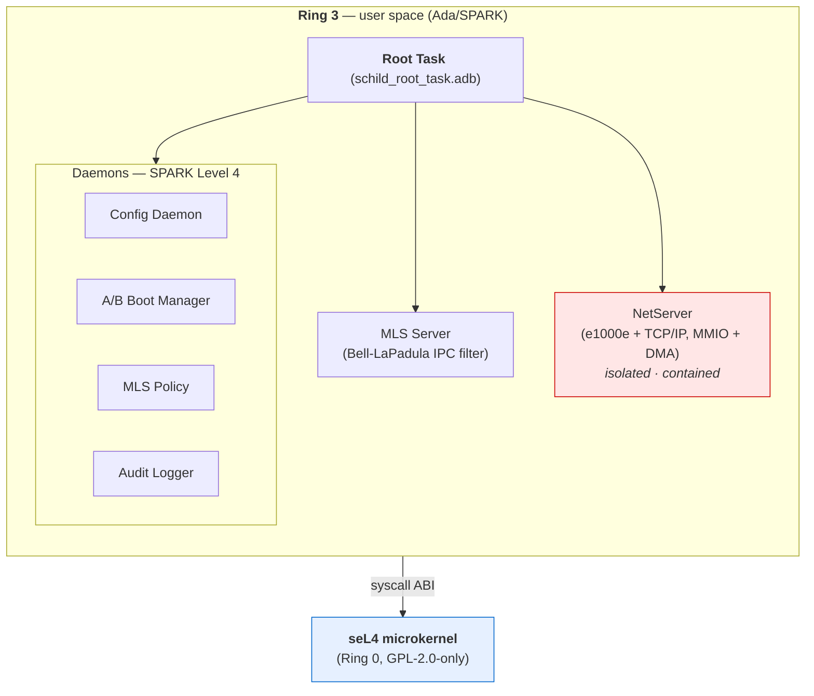

# Schild TCB: A Reference Architecture for Formally Verified Services on seL4

> Draft compiled from existing docs (`THREAT_MODEL.md`, `ARCHITECTURE.md`,
> `GUIDE.md`, `ASSURANCE.md`). Screenshots are placeholders to be inserted by
> the author; the SPARK numbers are generated from `obj/proof/metrics.json`
> (see the metrics block in Results).
>
> Concept DOI (all versions): [10.5281/zenodo.24446686](https://doi.org/10.5281/zenodo.24446686) · This release (v1.0.0-textbook): [10.5281/zenodo.24446687](https://doi.org/10.5281/zenodo.24446687)

## Abstract

Schild TCB is a research prototype of a Trusted Computing Base that pairs the
formally verified seL4 microkernel [Klein2009] with an Ada/SPARK 2022 user-space
environment.
The security-critical core — an MLS Bell-LaPadula policy, a capability model, a
process table, and firewall verdicts — is proved at SPARK Level 4 with zero
unproved verification conditions (the canonical module counts are generated
from `obj/proof/metrics.json`; see the metrics block in Results). Untrusted
periphery (network driver and storage) runs isolated in Ring 3, so a fault or compromise
there cannot reach the proved core. The system boots on a ThinkPad T580 and in
QEMU, with an ARM64 (Raspberry Pi 4B) port in progress. This paper describes the
architecture, the threat model, and the contract-driven verification approach,
and states the honest limits of the current prototype (no DMA isolation, weaker
x86_64 MCS verification).

## Introduction

Modern systems concentrate privilege in a single monolithic kernel: one memory
bug in any driver — network, storage, USB — yields full compromise. Formal
verification of such a kernel is intractable, so the industry patches
reactively. The alternative, followed here, is to make the *trusted* part small
enough to verify and to *isolate* everything else.

A second pressure is capability, not surface: autonomous AI agents lower the
cost of chaining many bugs into one exploit to near zero — a dynamic made
concrete by AI-assisted discoveries such as the Linux kernel use-after-free
[CVE202698432] found by Claude [Anthropic2026Claude]. Against such an
adversary the only controls that do not degrade are machine-checkable proof and
kernel-enforced isolation (THREAT_MODEL §3.2). Schild TCB is an experiment in
building exactly that: a proved core plus contained periphery.

The code and proofs are open: <https://github.com/Nik0laic4/SchildTCB>.

## Architecture

Two artifacts, separated by the syscall ABI:

- **seL4 microkernel** (Ring 0) — upstream, formally verified [Klein2009];
  locally patched (SMAP, object zeroing, framebuffer). ~186 KB, PRINTING=ON.
- **Root task** (Ring 3) — Ada/SPARK 2022, ~239 KB with NetServer. Orchestrates
  daemons and the two-level ARINC-653 schedule [ARINC653, Rushby1999].

```
Ring 3 ── Root Task (Ada/SPARK)
             ├ Config Daemon · A/B Boot Manager · MLS Policy · Audit Logger  (SPARK L4)
             ├ MLS Server (Bell-LaPadula IPC filter)
             └ NetServer (e1000e + TCP/IP, MMIO + DMA)   ← isolated, contained
──────────────── syscall ABI ────────────────
Ring 0 ── seL4 microkernel (GPL-2.0-only)
```

Isolation is three-fold: **CSpace** (own CNode), **VSpace** (own ASID-bound page
table), and **IRQ/DMA** (dedicated notifications + DMA frame). A fault in
NetServer is caught by the fault handler and contained without rebooting.

Trust is split by tier (ASSURANCE.md): **Tier A** (proved core: MLS, capability
model, process table, firewall verdicts), **Tier B** (contained periphery:
network/storage), **Tier C** (explicitly-labelled scaffold). The rule is that
Tier A depends on Tier-B *specifications*, never Tier-B *bodies*.

## Threat Model

Assets (A1–A6): the proved core, the isolated periphery, the TCB runtime, the
audit log, the boot/update path, and the platform. Four adversary classes:

- **P1 — remote network attacker** (reaches only the TCP/IP/HTTP surface);
- **P2 — compromised Tier-B domain** (already inside an isolated driver);
- **P3 — malicious/compromised peripheral** (DMA-capable device);
- **P4 — local build/deploy access** (can replace images).

On top of P1–P4, the **AI-agent cascade** is a capability axis, not a fifth
class: it multiplies existing classes by lowering cost and by chaining bugs
(THREAT_MODEL §3.2). Every unproven line is assumed already exploitable.

## Implementation & Verification

The proved core is written in SPARK [AdaCoreSPARK], with every security property
re-expressed as a contract and discharged by `gnatprove --level=4 --mode=all`
(CVC5/Z3/Alt-Ergo). The method (THREAT_MODEL §10): `Pre` accepts **all** legitimate
inputs, `Post` states the **security property**, liveness is validated by
runtime/KAT tests rather than proof, vacuity is rejected, and `pragma Assume`
stays at zero.

Representative proved properties: CBC chaining (`schild_aes_cbc_engine`),
maximum-priority scheduling + ARINC-653 MTF (`schild_scheduler`, `schild_mtf`),
Bell-LaPadula no-read-up/no-write-down (`schild_server_security_policy`,
`schild_file_descriptors`), and memory-safe network parsers
(`schild_arp/ipv4/icmp/udp/tcp_handler`). Techniques and gotchas are collected
in `SPARK_PROOF_TECHNIQUES.md`; a build→run→verify tutorial is `GUIDE.md`.

## Results

<!-- METRICS:START (generated by scripts/generate_metrics.py — do not edit) -->
**SPARK metrics** (commit `b874871`, 2026-11-23): **189 swept** · **179 in proof** (133 proved · 44 skipped · 2 no-output) · **10 scaffold excluded** · **0 unproved VCs**.

Accounting: `swept` = all modules; `in_proof` = `swept` − `scaffold_excluded`; `proved + skipped + no_output + not_proved` = `in_proof`. Source: `obj/proof/metrics.json`.
<!-- METRICS:END -->

- 8 root-task daemons proved (`verify.sh`); full private bodies (`verify_private.sh`).
- Build: **184 objects, 0 errors**; boots on a **ThinkPad T580 (32 GB)** and QEMU.

> `[SCREENSHOT: gnatprove summary — 0 unproved VCs]`

The fault-containment and temporal-isolation markers are shown in
Listing~\ref{lst:containment}.

## Limitations & Future Work

- **No DMA isolation** — IOMMU/VT-d is upstream-experimental; the Pi 4 has no SMMU. Isolation is process-level, not bus-level (P3 remains a residual risk).
- **x86_64 MCS** is formally verified weaker than ARM MCS (upstream).
- **Unproven C code** (C shims, drivers) — memory-unsafe, backed only by containment.
- **No signed boot / HWRoT** — SHA-256 detects corruption, not malice.
- **PID reuse** (CVE-2026-SCHILD-02 #005) — noted, not mitigated.

Next: a pilot use case ("protected network gateway with MLS", `USE_CASE.md`),
the ARM64/GENET port when hardware is available, and per-property contract
strengthening toward the full end-to-end security property.

## Conclusion

Schild TCB demonstrates a pragmatic path between "verify the whole OS"
(intractable) and "patch reactively" (not credible against AI-speed
adversaries): keep the trusted core small and *proved*, and make everything else
*contained*. The result is a per-component, mechanically checkable assurance
story rather than a broad "high-assurance" label — with the remaining gaps (DMA
isolation, signed boot) stated honestly rather than hidden.

## References

> In-text keys (`[Klein2009]`, `[AdaCoreSPARK]`, …) map 1:1 to the BibTeX entries
> below; copy them into the LaTeX `\bibliography`. The repository link is stated
> in the Introduction.

```bibtex
% seL4 formal verification (Klein et al., 2009)
@inproceedings{Klein2009,
  author    = {Klein, Gerwin and Elphinstone, Kevin and Heiser, Gernot and
               Andronick, June and Cock, David and Derrin, Philip and
               Elkaduwe, Dhammika and Engelhardt, Kai and Kolanski, Rafal and
               Norrish, Michael and Sewell, Thomas and Tuch, Harvey and
               Winwood, Simon},
  title     = {{seL4: Formal Verification of an OS Kernel}},
  booktitle = {Proceedings of the 22nd ACM Symposium on Operating Systems
               Principles (SOSP '09)},
  pages     = {207--220},
  year      = {2009},
  publisher = {ACM},
  address   = {Big Sky, Montana, USA},
  doi       = {10.1145/1629575.1629596}
}

% SPARK 2014 / GNATprove Level 4 (AdaCore official guide)
@manual{AdaCoreSPARK,
  author       = {{AdaCore}},
  title        = {{SPARK 2014 User's Guide}},
  organization = {AdaCore},
  year         = {2024},
  url          = {https://docs.adacore.com/spark2014-docs/html/ug/},
  note         = {Accessed 2026-11-01}
}

% AI-discovered Linux kernel vulnerability (use-after-free in TCP SYN handling).
@misc{CVE202698432,
  title        = {{CVE-2026-98432}: Linux kernel use-after-free via race in
                   IPv4 TCP SYN/SYN-ACK handling (remote code execution with
                   root privileges when an MPTCP listener is present)},
  howpublished = {\url{https://nvd.nist.gov/vuln/detail/CVE-2026-98432}},
  year         = {2026},
  note         = {Also recorded at
                   \url{https://www.cve.org/CVERecord?id=CVE-2026-98432};
                   present since kernel 4.4}
}

% Anthropic — primary source for the AI-assisted discovery of CVE-2026-98432.
@misc{Anthropic2026Claude,
  author       = {{Anthropic}},
  title        = {{Discovering Vulnerabilities with Claude}},
  howpublished = {\url{https://www.anthropic.com/research/discovering-vulnerabilities-with-claude}},
  year         = {2026},
  note         = {Primary source for the AI-assisted discovery of CVE-2026-98432}
}

% ARINC 653 standard (partitioned / two-level scheduling)
@techreport{ARINC653,
  author      = {{Airlines Electronic Engineering Committee (AEEC)}},
  title       = {{ARINC Specification 653: Avionics Application Software
                  Standard Interface}},
  institution = {Aeronautical Radio, Inc.},
  year        = {2003}
}

% Partitioning in avionics — rationale for the ARINC-653 scheduler model
@techreport{Rushby1999,
  author      = {Rushby, John},
  title       = {{Partitioning in Avionics Architectures: Requirements,
                  Mechanisms, and Assurance}},
  institution = {SRI International},
  year        = {1999},
  note        = {NASA Contractor Report CR-1999-209347}
}
```

## Figures & Tables (for LaTeX)

### Figure 1 — Architecture (block diagram)

Mermaid source — paste into <https://mermaid.live>, or draw.io → Arrange → Insert
→ Advanced → Mermaid (draw.io imports Mermaid directly):



Layout spec for draw.io/Excalidraw (manual redraw): two horizontal bands —
top «Ring 3 (user space)», bottom «Ring 0». Top band: one «Root Task» box with
three children (a group of 4 daemons, the MLS Server, the NetServer) connected
by arrows. NetServer tinted red («isolated · contained»); a dashed line labelled
«syscall ABI» separates the bands; seL4 box tinted blue.

### Table 1 — Verification results (LaTeX, booktabs)

```latex
\begin{table}[ht]
\centering
\caption{Representative proved properties and the mechanical check that discharges them.}
\label{tab:verification}
\begin{tabular}{@{}llll@{}}
\toprule
\textbf{Module} & \textbf{Proved property} & \textbf{Verification} & \textbf{Status} \\
\midrule
schild\_server\_security\_policy & Bell-LaPadula: no read-up / no write-down / strict IPC & prove\_kernel.sh & Proved \\
schild\_scheduler + schild\_mtf & maximum-priority ready task; ARINC-653 totality & prove\_kernel.sh & Proved \\
schild\_aes\_cbc\_engine & CBC chaining (FIPS 800-38A) & prove\_kernel.sh & Proved \\
schild\_file\_descriptors & Bell-LaPadula soundness (no false access grant) & prove\_kernel.sh & Proved \\
schild\_cap\_space / process\_manager & capability + MLS invariants & prove\_kernel.sh & Proved \\
schild\_arp/ipv4/icmp/udp/tcp\_handler & memory-safe parsers (buffer-bound Pre) & prove\_kernel.sh & Proved \\
8 root-task daemons & daemon logic & verify.sh & Proved \\
e1000e / NVMe / network stack & drivers — not proven (no hardware spec) & run\_tests.sh & Contained \\
\midrule
\textbf{canonical metrics (see the Results block)} & \textbf{0 unproved VCs} & prove\_kernel.sh & \textbf{Pass} \\
\bottomrule
\end{tabular}
\end{table}
```

### Figure 2 — Containment markers (listing)

```latex
\begin{lstlisting}[language=bash, caption={Runtime validation of fault containment and temporal isolation on QEMU.}, label={lst:containment}]
PASS  [CONTAINMENT] injecting fault into NetServer
PASS  [FAULT] Caught fault
PASS  [CONTAINMENT] core alive after fault
PASS  [FAULT] Caught MLS fault
PASS  [CONTAINMENT] MLS server contained
PASS  [TIMEOUT] Caught budget overrun
PASS  ==== Root Task ready ====
\end{lstlisting}
```

