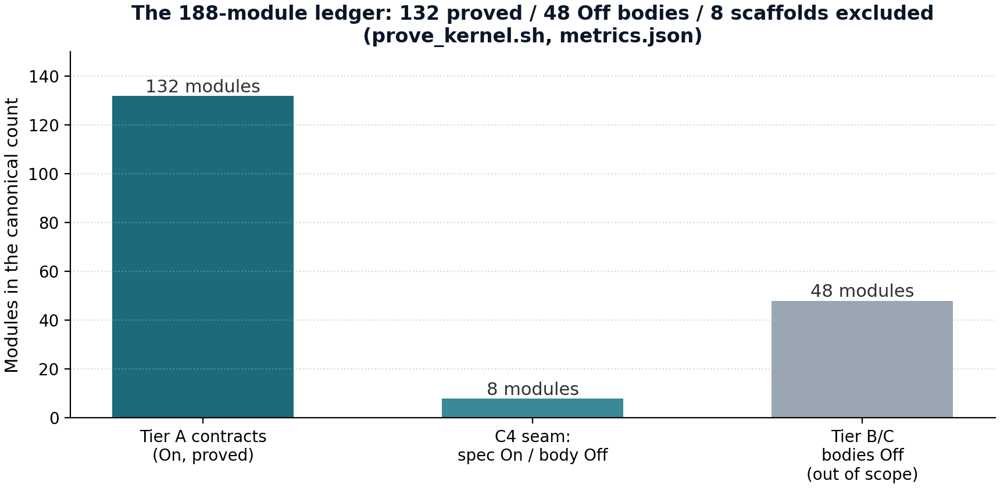
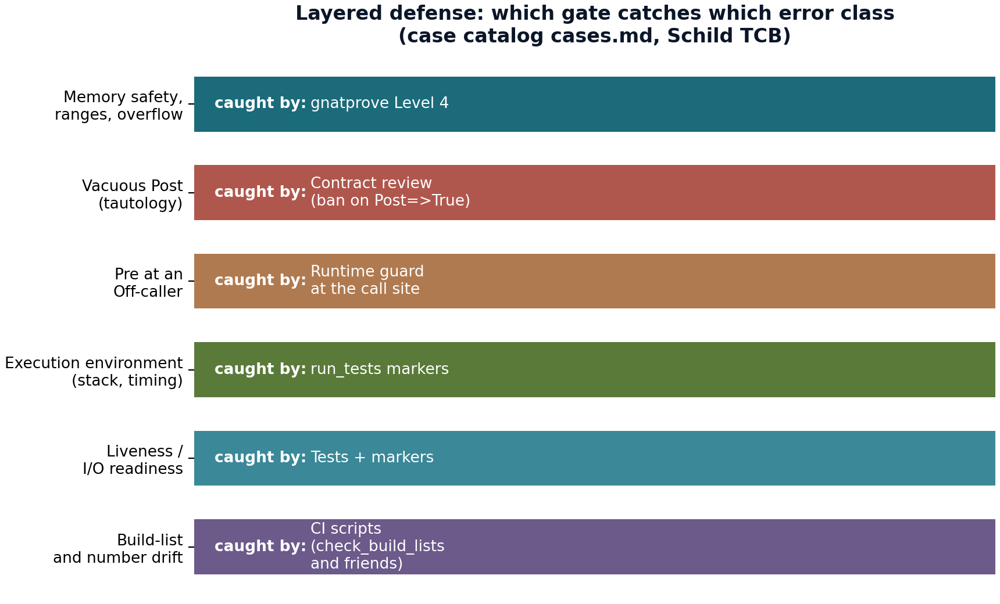

# Schild TCB: A Field Guide to Walking a Minefield

> **COMMUNITY TEXTBOOK DRAFT**
>
> Moments from the engineering changelog, untangled through the code: from a vacuous contract to the dead gate

| | |
|---|---|
| **Source of moments** | docs/technical/CHANGELOG.md (v0.8.0-pre → v0.56) |
| **Material untangled from repository files** | commit `8d67ecc` (2026-11-20) |
| **Chapter format** | moment → code → why it happened → lesson for the community |
| **Prepared by** | Alexander Irganov (project author) |
| **Stack** | Ada/SPARK + seL4 + QEMU + real laptops |
| **Date** | November 21, 2026 |

---

## Contents

- [From the editor: why this collection exists and how to use it](#from-the-editor-why-this-collection-exists-and-how-to-use-it)
- [Chapter 1. The vacuous contract: a Post that passed every gate](#chapter-1-the-vacuous-contract-a-post-that-passed-every-gate)
- [Chapter 2. When the prover can't cope: unconstrained String and the constrained-type recipe](#chapter-2-when-the-prover-cant-cope-unconstrained-string-and-the-constrained-type-recipe)
- [Chapter 3. A proof that doesn't travel: Pre at an Off-caller](#chapter-3-a-proof-that-doesnt-travel-pre-at-an-off-caller)
- [Chapter 4. Proved ≠ works: stack alignment and the silent hang](#chapter-4-proved--works-stack-alignment-and-the-silent-hang)
- [Chapter 5. A capability-space slot map: one constants file instead of magic](#chapter-5-a-capability-space-slot-map-one-constants-file-instead-of-magic)
- [Chapter 6. A daemon with its own CSpace: closing the "Signal arbitrary notifications" vector](#chapter-6-a-daemon-with-its-own-cspace-closing-the-signal-arbitrary-notifications-vector)
- [Chapter 7. One shift: a null-cap in every heartbeat](#chapter-7-one-shift-a-null-cap-in-every-heartbeat)
- [Chapter 8. Fault injection out of production: the preprocessor as part of the gate](#chapter-8-fault-injection-out-of-production-the-preprocessor-as-part-of-the-gate)
- [Chapter 9. What the oracle doesn't catch: the echelon map from the case catalog](#chapter-9-what-the-oracle-doesnt-catch-the-echelon-map-from-the-case-catalog)
- [Chapter 10. The changelog as a genre: reading verified results](#chapter-10-the-changelog-as-a-genre-reading-verified-results)
- [Chapter 11. PID reuse: an identifier that returns too soon](#chapter-11-pid-reuse-an-identifier-that-returns-too-soon)
- [Chapter 12. Persist that silently fails: I/O outside the model](#chapter-12-persist-that-silently-fails-io-outside-the-model)
- [Chapter 13. Two build lists: the mechanical-drift class](#chapter-13-two-build-lists-the-mechanical-drift-class)
- [Chapter 14. Patches on a verified kernel: reviewed ≠ re-proven](#chapter-14-patches-on-a-verified-kernel-reviewed--re-proven)
- [Chapter 15. The dead gate: verifying the verifier](#chapter-15-the-dead-gate-verifying-the-verifier)
- [Appendix A. The verified basis of this collection: where every number comes from](#appendix-a-the-verified-basis-of-this-collection-where-every-number-comes-from)
- [Appendix B. How to reproduce what you read](#appendix-b-how-to-reproduce-what-you-read)

---

## From the editor: why this collection exists and how to use it

Schild TCB is a research project: a trusted computing base built on the seL4 + SPARK pairing, developed by a single author paired with an AI agent and documented down to the smallest detail. The repository already has its own methodology and assurance case; this collection solves a different problem. The project's engineering changelog is a chronicle of roughly ninety verified moments, and some of them are things the embedded and high-reliability community is almost never shown live: a tautological contract that passed every gate; a proved cryptographic module that hangs because of stack alignment; a null-cap caused by a mis-encoded capability pointer.

Every chapter of this collection follows the same frame: a moment from the changelog (with version number and date), then the untangling through the repository's files — real code, a real comment, a real script gate — then an analysis of why it happened exactly the way it did, and finally the lesson: a generalized statement you can carry into any other project. Code in the chapters is quoted verbatim from the cloned repository's files (commit 8d67ecc), with paths given; long fragments are shortened with ellipses but never rewritten. The collection does not replace the project's documentation — it leads toward it, and each chapter ends by pointing at the repository document to read for the full context.

The order of chapters runs from contracts to the execution environment: first the "software" (chapters 1–3: vacuity, weak spots, prover limitations), then "hardware and structure" (chapters 4–5: alignment, the slot map), then "isolation and mechanisms" (chapters 6–8: own CSpace, CPtr encoding, fault-injection gating), and the collection closes with the methodological chapters (9–10: what the oracle doesn't catch, how to read a changelog) and the boundary cases where the oracle is powerless (chapters 11–15: PID reuse, the silent Persist, build-list drift, kernel patches, the dead gate). All the quantitative numbers come from the project's canonical metrics: 188 modules in the sweep, 132 proved, 48 Off bodies, 8 scaffolds excluded, 0 unproved verification conditions.



*Fig. 1. The canonical module ledger: 132 proved / 48 Off bodies / 8 scaffolds (metrics.json)*

---

## Chapter 1. The vacuous contract: a Post that passed every gate

The changelog moment is dated November 1, 2026 (W11.1). The wording is maximally honest: "vacuous Post (passed all gates)". The module in question is `schild_audit_chainer` — a link in the audit chain whose outward appearance was perfect: `SPARK_Mode => On`, Level 4, all verification conditions proved. The problem is that what was proved was an empty statement: the postcondition of the `Is_Chain_Valid` function in the old version was the constant `True`, i.e. a tautology. The oracle honestly proved the tautology and could not complain: gnatprove checks that the body implements the contract, but it does not check that the contract demands anything.

Let's untangle it through the file. The module's current specification, `src/schild_core/src/03_crypto/schild_audit_chainer.ads`, already carries the fixed version of the contract, and next to it a comment written by the author during the fix: the contract does not pretend to be cryptography (the XOR fold is a stand-in for a real hash function), but it proves the chaining property itself.

> `src/schild_core/src/03_crypto/schild_audit_chainer.ads`, lines 25–39

```ada
procedure Link_Audit_Record
  (Previous_Hash : in     Hash_Digest_Type;
   Record_Payload : in     Hash_Digest_Type;
   Current_Hash  : in out Hash_Digest_Type;
   Passport      :    out Blockchain_Passport_Record;
   Success       :    out Boolean)
with
  Post => Success
          and Passport.Is_Chain_Valid
          and Passport.Block_Sequence_Id = 1
          and (for all I in Current_Hash'Range =>
                 Current_Hash (I) = (Previous_Hash (I) xor Record_Payload (I)));
```

Mentally compare it with the old version: `Post => True`. The difference is not stylistic. The new contract fixes the dependency of every link on its predecessor and on the payload: change any record — and every subsequent link changes. That is precisely the tamper-evidence property from the threat model (asset A4), written as a single quantifier line. The comment in the specification also voices the boundaries: the XOR fold is a stand-in, the real SHA-256 lives in `Schild_HMAC_SHA256` with an Off body validated against known answers (KAT); the link is not yet wired into the live audit path. The honesty of the listed caveats is part of the finding: the contract became meaningful exactly when it stopped claiming more than it proves.

How the project catches this now: contract review is the only echelon that can see a tautology, so the pre-commit gate `forbidden_check.sh` has a dedicated rule forbidding a `Post => True` line in the diff. This is a rare example of a gate guarding not execution but meaning: it will not let a tautology slip back into the codebase unnoticed.

> `src/schild_core/scripts/forbidden_check.sh`, fragment of rule H2

```bash
H2=$(echo "$DIFF" | grep -E '^\+[[:space:]]*Post[[:space:]]*=>[[:space:]]*\(?(True)?' || true)
if [ -n "$H2" ]; then
  echo "FORBIDDEN: Post => True (vacuous contract)"
  FAIL=1
fi
```

> **Lesson.** "not-proved: 0" says nothing about whether contracts are meaningful. A tautological Post is the one class of vacuity the prover skips by construction; review and a literal ban in a gate are what must catch it. When designing contracts, ask not "can this be proved?" but "what does it forbid a false body from doing?"

---

## Chapter 2. When the prover can't cope: unconstrained String and the constrained-type recipe

A moment from the same W11 wave (November 1): the HTTP parser resisted proof, and gnat2why "exploded" on loops over an unconstrained `String`. The index of such a type is `Positive`, i.e. 1..2³¹, and the prover has to consider an abyss of cases. The changelog entry is tagged as gotcha §4.5, and the solution took shape as a separate package `schild_http_core`, which today stands in the repository as the model of "how to extract an external-input parser into a provable core".

The recipe reads right off the top of the file: instead of unconstrained types, constrained subtypes of fixed width, with the length passed as an explicit parameter.

> `src/schild_core/src/04_userland/schild_http_core.ads`, lines 11–34

```ada
package Schild_Http_Core with SPARK_Mode => On is

   Max_Path_Len : constant := 24;
   subtype Path_String is String (1 .. Max_Path_Len);

   Max_Request_Len : constant := 1024;
   subtype Request_Buffer is Schild_Net_Types.Byte_Array (0 .. Max_Request_Len - 1);

   Max_Pattern_Len : constant := 12;
   subtype Pattern is String (1 .. Max_Pattern_Len);

   function Str_Match
     (B : Request_Buffer; Request_Len : Integer; P : Pattern; P_Len : Integer)
     return Boolean
     with Pre => Request_Len in 0 .. Max_Request_Len
                 and P_Len in 0 .. Max_Pattern_Len;
```

Notice how the contract shrinks after the type change: preconditions turn into uniform range-membership checks — `Request_Len` within the buffer bounds, `P_Len` within the pattern bounds. The body does not get more complicated: the loops are the same, but the index is already bounded by 0..1023 and 1..12 instead of billions. In the project's technique this is documented in `SPARK_PROOF_TECHNIQUES.md` as "prover limitation, SOLVED W11.3": the same section lists other constructs of this nature — the unconstrained `Byte_Array` and loops over `String` — with the conclusion: constrained types plus an explicit length parameter. A corollary for the community: the extraction pattern should be applied not to the whole program but to the boundary. The parser is the attacker's entry point (threat T1), so that is what gets extracted into an On package; the server wrapper stays Off and only owes a runtime guard before the call (chapter 3 covers this).

One more stone from the same day: the `Write_U32_Dec` function, which wrote a decimal number right-to-left. The bug "V = 0 emitted nothing" (a Content-Length of pure spaces) was found during the extraction, and in the new version the empty case is gone by construction: the digit count is returned by a separate function with an honest range postcondition, and the write loop iterates exactly that many positions.

> `src/schild_core/src/04_userland/schild_http_core.ads`, lines 40–50; `.adb`, lines 88–100

```ada
function Digit_Count (V : Unsigned_32) return Integer
  with Post => Digit_Count'Result in 1 .. 10;

procedure Write_U32_Dec
  (B : out Byte_Array; Idx : in out Integer; V : Unsigned_32)
  with Pre  => Idx in B'First .. B'Last
               and then Idx + Digit_Count (V) - 1 <= B'Last,
       Post => Idx = Idx'Old + Digit_Count (V),
       Relaxed_Initialization => B;
-- body: for K in 0 .. D - 1 loop
        B (Idx + D - 1 - K) := 48 + Unsigned_8 (Val rem 10); Val := Val / 10;
```

> **Lesson.** If the prover "hangs" on a string loop — don't wait for it: narrow the type (fixed width, index from 0) and pass the length as a parameter. The contracts then simplify down to range checks. Extract into the provable core only the boundary that faces external input; leave the rest Off with explicit guards.

---

## Chapter 3. A proof that doesn't travel: Pre at an Off-caller

The third moment from the same wave (case C23 in the methodology catalog). SPARK proves a call correct when the precondition holds, but if the calling code is marked `SPARK_Mode => Off`, the precondition is not checked at the call site — the proof does not extend to an Off-caller. In the project this happened with the HTTP handler: an On-parser with an honest `Pre` (path 5..1024) was called from an Off server where no guard stood. The proof was green; the call would lawfully corrupt memory on a short or overlong request.

The mechanism deserves to be seen in code. Below is the call site of a provable function from Off code, with the guard added after the finding. Note the asymmetry of responsibility: the On core declares the Pre; the Off wrapper owes a check of it before the call.

> `src/schild_core/src/04_userland/schild_http_server.adb`, guard fragment before the core call

```ada
-- The Off-caller must check the On-core's Pre before calling:
if Request'Length < 5 then
   -- 404: request too short, Extract_Path'Pre violated
   Success := False; return;
elsif Request'Length > 1024 then
   -- 414: too long, Write_U32_Dec'Pre and the core's buffers are sized for 1024
   Success := False; return;
end if;
-- only now the call to schild_http_core.Extract_Path / Write_U32_Dec
```

In changelog W11.2 the same wave found a symmetric case in the network parsers: `Parse_Arp` and `Parse_Ipv4` gained defensive early exits, because the (Off) dispatcher slices the frame by a computed length, and a runt of 14–33 bytes reached a parser whose length Pre nobody had checked. Today the bodies carry explicit thresholds — a full ARP datagram is never shorter than 28 bytes, an IPv4 header than 20:

> `schild_arp_handler.adb`, line 31; `schild_ipv4_handler.adb`, line 33

```ada
if Raw'Length < 28 then return; end if;  -- ARP: full datagram >= 28 bytes
if Raw'Length < 20 then return; end if;  -- IPv4: header >= 20 bytes
```

> **Lesson.** Any Off-caller invoking On code with a Pre is a place where the proof breaks off. The rule: before calling an On core, Off code must duplicate the precondition as a runtime guard (or call through a checking wrapper). Keep a map of such call sites and review it on par with the contracts.

---

## Chapter 4. Proved ≠ works: stack alignment and the silent hang

The moment is dated November 7 (v0.34, case H61). HMAC-SHA256 in the FS daemon was proved and validated against test vectors, yet the daemon silently hung on its first call. The cause turned out to be in the execution environment: the thread's stack was offset by 8 bytes (eight bytes of the liveness flag precede the eight-kilobyte stack, so the stack top is congruent to 8 modulo 16), while the crypto core uses the aligned SSE instructions `movaps`/`movdqa`, which raise #GP on an unaligned address. No gate sees this: the formal model contains no notion of alignment, tests can't see a silent hang, and the laptop has no serial port.

The fix is one line of assembly in the daemon's startup code, and it still stands in the file:

> `src/schild_core/tools/sel4/src/fs_daemon.S`, lines 7 and 12

```asm
andq    $-16, %rsp   # align the stack top to 16 bytes before any SSE
.align 16               # and keep the stack block itself aligned
```

Why the community should read this chapter: it is the purest specimen of an error class that neither proof nor markers catch, and which looks "impossible" to an author who has just received a green proof. Out of this case the project grew a three-echelon practice for the execution environment: progress markers in `run_tests.sh` (their absence localizes the hang), binary search over the stage, and the rule "a proved module must have a deliberately designed entry point into the environment". And here is how the human actually searched: not from the prover, but from the markers — which one printed last before the silence.

A bonus from the same release — a parallel case of the same class: the silent TX DMA failure. An HTTP response longer than 64 bytes was read by the device as garbage, because the cache flush covered only the first cache line (`clflush` is per-line), and DMA read the remaining lines as stale. The cure is a flush loop over the whole buffer in 64-byte steps. The class is the same: proved logic and unproved environment (cache, alignment, timing) are different worlds.

> **Lesson.** The oracle proves the logic inside the model; the execution environment (alignment, DMA cache coherence, timing) is invisible to it. For hangs that don't diagnose themselves, keep: stage markers, the "last one printed" as the binary-search pivot, and explicit entry contracts into the environment (stack alignment in every thread's startup code).

---

## Chapter 5. A capability-space slot map: one constants file instead of magic

A moment from October 4 (the "8 KiB boot-info frame + 500 untyped caps" entry), continued in H112 (v0.55, November 20). On a machine with 32 GB of RAM, the boot region of untyped descriptors stretched to ~577 slots, the root task's fixed slots landed inside a foreign region, and the kernel started refusing with "Slot non-empty". The project's reaction was not to fudge numbers but an architectural move: the entire slot map is declared in one place as constants from a common `Slot_Base = 4096`, above the maximal boot region, and the script `check_slot_layout.sh` verifies offset uniqueness at build time.

Reading the map. The seam specification `schild_sel4_syscall.ads` opens with the justification: the boot untyped-caps region ends around slot ~577, all dynamic objects are placed from `Slot_Base = 4096`, so collisions are impossible under any memory fragmentation:

> `src/schild_core/tools/sel4/src/schild_sel4_syscall.ads`, lines 28–60 (abridged)

```ada
Slot_Base : constant Cap_Ref := 4096;

MLS_EP_Slot         : constant Cap_Ref := Slot_Base + 0;   -- 4096
MLS_Fault_Slot      : constant Cap_Ref := Slot_Base + 1;
...
-- Every line: a name, an offset from the base, the decimal absolute number in a comment.
-- Dynamic objects (endpoints, TCBs, frames, VSpaces) live only >= Slot_Base,
-- so they never collide with the untyped region, however fragmented the memory.
```

The second layer of defense is the checker. It greps every `Slot_Base + N` record in the specification, finds duplicate offsets, and fails the build if any appear; daemon windows (image/mint) are printed for manual non-overlap review. This is that rare case where a ten-line script closes an entire class of placement errors that is otherwise caught only by a hung boot.

> `src/schild_core/scripts/check_slot_layout.sh`, lines 17–24

```bash
dups=$(grep -oE 'Slot_Base \+ [0-9]+' "$ADS" | awk '{print $3}' | sort | uniq -d)
if [ -n "$dups" ]; then
  echo "FAIL: duplicate slot offsets:"; echo "$dups" | sed 's/^/  +/'
  exit 1
fi
echo "PASS: no duplicate static slot offsets"
```

The key idea for the community: the map lives in data, not in code — a constants file of the specification is read by machines (the checker), by humans (window review), and by history (comments record past collisions with slot numbers and causes — see the `MLS_Image_Frame_Base` lines, where moving the base from +90 to +55 is explained by an exact mint-window calculation). When a boot fails in May with "Slot #4352 non-empty", you open one file and find the whole genealogy. And the "two names, one slot" class of error is caught before boot, by grep.

> **Lesson.** Keep static resources (slots, ports, addresses) in one constants file with boundary justifications and a history of moves, and back it with a machine uniqueness checker. A magic number in code is a future "Slot non-empty" that will only ever be caught by a hang.

---

## Chapter 6. A daemon with its own CSpace: closing the "Signal arbitrary notifications" vector

The moment is v0.55, November 20 (H112). The MLS and Config daemons ran in the root CNode — that is, they held capability rights in the root task's space. The threat statement in the spec is lethal in its simplicity: a compromised daemon could Signal `IRQ_Ntfn`, `Timeout_EP`, or `Root_Fault_EP` in the root CSpace — that is, manipulate the timers and fault handling of the very task that is obligated to restart it. The cure: a dedicated 4-radix CNode per daemon with a strictly minimal set of rights, and the fault handler moved to the daemon's own space.

> `src/schild_core/tools/sel4/src/schild_sel4_syscall.ads`, lines 78–82

```ada
-- H112: own CSpace for MLS/Config (was root CNode=2). A compromised
-- MLS/Config could Signal IRQ_Ntfn/Timeout_EP/Root_Fault_EP in the root
-- CSpace; the own CNode holds only the minimal caps.
MLS_CSpace_Slot     : constant Cap_Ref := Slot_Base + 32;  -- 4128
Config_CSpace_Slot  : constant Cap_Ref := Slot_Base + 33;  -- 4129
```

The moment's value is not the fact that rights were separated (for seL4 that is the alphabet) but three things around it. First: the threat is stated in a comment on the constant, so document and code physically coincide — which dissolves the eternal "the doc said one thing, the code does another" problem. Second: the minimality of the set is explicit — only the endpoint, reply, and ping notification; everything not listed does not exist. Third: the change landed without rewriting the daemons — only the mounting point of their rights changed, which is what makes this class of fix cheap once the slot map (chapter 5) is already kept as data.

For a textbook, this is the chapter saying that isolation is not the property "runs separately" but the property "cannot". While the daemon ran in the root CNode, it was a separate thread in a separate VSpace — by every outward sign "isolated" — yet it held rights that let it shoot at its parent's notifications. The review question for any seL4 build: "which objects can this daemon touch through its CSpace?" — and if the answer is longer than three slots, that is already a question for the author.

> **Lesson.** Isolation on seL4 is the minimality of the CSpace, not the separateness of the process. State the threat in a comment on the constant, enumerate the minimal right set explicitly, and move daemons onto their own spaces with one motion of the slot map.

---

## Chapter 7. One shift: a null-cap in every heartbeat

Also from v0.55: a bugfix with no residual number but with perfect didactics. Four C daemons send the heartbeat ping notification via a `signal(2)` call — an integer first argument. But the daemon's own CNode is 4-radix: the slot index is extracted from the capability word as `capptr >> (wordBits − radix)` = `capptr >> 60`, so slot 2 must be passed as `2ULL << 60`. The daemons passed the raw two; the kernel decoded it as slot 0 (2 >> 60 = 0), and slot 0 is a null cap. The result: on every heartbeat the kernel answered "Attempted to invoke a null cap", and the heartbeat did not work at all — in an outwardly green system.

> `src/schild_core/tools/sel4/src/mls_server.c`, line 55 (the same line in config_daemon.c, fs_daemon.c, netserver.c)

```c
schild_sel4_signal((2ULL << 60));  /* own-CSpace CPtr = index<<60 (slot 2 = ping ntfn) */
```

The moment is valuable not for the bug (capability-pointer encoding is an ordinary trap) but for how it was found and closed. The symptom was soft (a "null cap #2" line in the log on every ping), the fix is one line in four files — but with a comment that forever binds the magic number to the radix semantics: "index<<60". Before this, the same places held "raw" 1/2/3 — meaning the bug lived in the class "magic constants with no justification", and it vanished together with the class.

A second layer: even after the fix the heartbeat would have stayed brittle had it not been tested. The ping marker is now part of the mandatory set in `run_tests.sh` (chapter 9 explains why markers are a separate echelon). And a third layer, the didactic one: CPtr encoding is the place where an "ordinary C integer" and a "seL4 capability word" live in the same expression. The compiler does not distinguish their types; only the comment and the convention do. If your code carries integers that are really encoded CPtrs, get yourself a wrapper function or macro whose name says so.

> **Lesson.** An integer argument that is really a capability word must be encoded in one place, with a comment on the radix. The standing review question for seL4 code: "where does this number come from, and what does the kernel decode out of it?" Raw slots in arguments are the eggs of future null-caps.

---

## Chapter 8. Fault injection out of production: the preprocessor as part of the gate

The moment is v0.56, November 20 (M20). The daemons carried fault-injection code: op=98/op=99, under which a daemon deliberately wrote to an unmapped page or spun in a loop — for the isolation and timeout-recovery tests. The code was needed by tests and dangerous in production: a shot in the foot hidden behind a protocol constant. The solution: wrap every injection in `#ifdef SCHILD_SELFTEST` and make the macro's absence the default state — `build.sh` builds production with `SCHILD_SELFTEST=0`, `run_tests.sh` and CI set `=1`. The control is not trust in a comment but objdump: in the production binary the `0xDEADBEEF`/`0xFFFFF000` markers must be physically absent.

> `src/schild_core/tools/sel4/src/mls_server.c`, lines 77–92 (abridged); `build.sh`, line 165

```c
#ifdef SCHILD_SELFTEST
  if (op == 99) {
    /* Crash-containment test: reply first, then fault on unmapped
     * 0xFFFFF000 so seL4 delivers a #PF to the MLS fault endpoint. */
    result = 0;
    ...
  }
#endif

# build.sh (production default):
SCHILD_SELFTEST="${SCHILD_SELFTEST:-0}" bash tools/sel4/build_rt.sh
```

What makes the moment teachable. First: the feature flag here is not a configuration option but part of the verification model; "injection code absent from the binary" is a checkable property, checked by a dedicated stage (objdump in a gate), not by an assertion in documentation. Second: the gating is two-sided — the Ada injection driver in the root task is gated by `schild_selftest_enabled()`, which is only honored at the root task, so even a flag turned on by tests does not give daemons an injection without the parent's consent. Third: the tests do not weaken — all 24 `run_tests` markers still demand the injection branches, only now those branches physically live in a separate build.

The general principle to carry away: any "test-only" behavior must be mechanically removable and mechanically checkable as removed. Otherwise one day a tired builder will leave the daemon's self-destruction weapon in the production image, and no gate will notice.

> **Lesson.** Keep test doors (fault injection, debug operations) behind a preprocessor flag, off by default, with an objdump check of absence in production. An "induced fault" in a production binary is not a testing instrument; it is a mine.

---

## Chapter 9. What the oracle doesn't catch: the echelon map from the case catalog

This chapter gathers the conclusion of all the previous ones into a single table. In the project it lives in `docs/methodology/cases.md` as the "common pattern" — seven cases, each with "catches / does not catch" columns. We reproduce the table compactly, cross-checked against the gate code, and add an eighth row — the dead-gate incident of November 2026, which is not yet in the catalog (it is our recommendation to the author from the audit report).

**Table 1.** Error class → who catches it (per cases.md + the 2026-11-19 incident)

| Error class | Caught by | Not caught by (does the prover see it?) |
|---|---|---|
| Memory safety, ranges, overflow | gnatprove Level 4 | — (inside the model) |
| Vacuous Post (tautology) | Review; the ban in forbidden_check.sh | gnatprove |
| Pre at an Off-caller | Runtime guard at the call site | gnatprove |
| Stack alignment / execution environment | run_tests markers + binary search | gnatprove |
| Liveness / I/O readiness | Tests + markers | gnatprove |
| Build-list and number drift | check_build_lists.sh, check_metrics_consistency.sh | gnatprove |
| A patch on the proved seL4 kernel | Per-patch review + risk analysis | the upstream guarantee transfers only partially |
| A dead gate (a gate that cannot fail) | External audit of the scripts | a gate does not check itself |

*Source: docs/methodology/cases.md "Common pattern", extended with the November 19 incident row*



*Fig. 2. Layered defense: which gate gets which error class (per the cases.md catalog)*

The intellectual core of the chapter is the catalog's conclusion, quoted verbatim: "the oracle covers one axis (formal correctness inside the model); everything else is covered in echelons — review for vacuity, a runtime guard for Pre at Off, markers for the environment, scripts for drift; that is the architecture of the pipeline." For the community this table is a ready checklist: if your organization is buying a "formally verified" product, ask, row by row, which echelon catches that class at this particular vendor. If the answer is "the prover" all the way down — you are looking at a gap, not a guarantee.

The dead-gate incident deserves a separate explanation, both because it is the eighth row and because it is fresh. On November 19 it turned out that the `verify.sh` and `verify_private.sh` gates searched gnatprove's output for a "not proved" line that does not exist in it — and so could not fail, in principle. The irony of the moment: the gates themselves were created as an echelon of trust in the prover, and it was precisely the echelon that broke, not the prover. The defect was caught by an external audit of the scripts — the last echelon, "a human reads the checking system itself". The moral for the community: every gate must itself be checked for the ability to fail (fail-on-demand), at least occasionally, by deliberate corruption.

> **Lesson.** Build the pipeline as echelons over error classes, not as one "strong" tool. And audit the gates themselves: a gate that cannot fail is not a gate but decoration; test it by corruption the same way code is tested by injection.

---

## Chapter 10. The changelog as a genre: reading verified results

This whole collection was built on reading one file — `docs/technical/CHANGELOG.md` — and the final chapter is about the genre itself. The file's header sets the rule: "this changelog records verified results only"; entries marked pending or target count as unvalidated. That turns the changelog from a diary into a source of facts: every entry carries a date, a version number, a validation line (which gates, with what result), and a change list with file names and exact slots/numbers. This is exactly why it can be "untangled": behind every moment stands a checkable point in the code.

Three reading techniques that paid off while preparing this collection. First: hunt for entries with failure wording — "was false", "silently", "previously", "hang", "NOT reproduce": that is the concentrate of experience, the rest is features. Second: read the "Gates:" lines as a quality stamp — they separate fact from plan (in this file, promises are marked pending and live separately). Third: every entry has an anchor in the tree — a file name or a slot; if there is no anchor, the entry is suspect. For instance, the v0.46 slot-collision entry carries the exact calculation: "base +90 → minted 4250..4254 collided with Image_Frame_Base 4224..4354 → Destination not empty; base +55 → minted 4215..4219 < 4224" — a paragraph from which you can reconstruct the slot geometry without opening the code.

> docs/technical/CHANGELOG.md, v0.46 (2026-11-09), verbatim

```text
MLS_Image_Frame_Base  Slot_Base+90 (4186) -> Slot_Base+55 (4151). Root cause:
Load_Segment mints a copy at Frame_Slot+64 per page; base +90 -> minted
4250..4254 collided with Image_Frame_Base 4224..4354 -> 'Destination not
empty', NetServer VSpace FAILED. Base +55 -> minted 4215..4219 < 4224.
```

The fourth technique is reading the series. The W10–W11 wave (network into the proof set) shows the strategy: first the parsers (ARP/ICMP), then transport (TCP/IPv4, with checksums rewritten into RFC 1071 modular arithmetic), then the HTTP parser's extraction into a separate constrained-type core. Each entry closes one step, and the order of the steps is itself a curriculum: from simple functions to contracts over state machines. The H87 wave (daemons into their own ELFs) reads the same way: first the ELF64 parser into a provable core (v0.39), then the kernel patch for loading the image above the kernel region (v0.40), then the first daemon (v0.42), and only then MLS/Config/NetServer (v0.46–v0.51).

And the last thing: the genre demands discipline in the writing. The "verified results only" rule works only because the project has gates whose results can be quoted (`run_tests 24/24`, `verify.sh 0`, `prove_kernel 132/48/0`). If your project has no machine numbers, the changelog degrades into marketing. Hence the practical advice for anyone wanting to start one: first set up at least one gate with machine output and an honest dump into a file, and only then keep the journal — then the "Gates:" line in every entry will be a reference, not a ritual.

> **Lesson.** A changelog under the "verified results only" rule is a map of checkable facts. Read the failure entries and the "Gates:" lines, demand an anchor (file/slot/number) in every entry, and don't keep such a journal without machine gates you can cite.

---

## Chapter 11. PID reuse: an identifier that returns too soon

The changelog moment is finding M1 (CVE-2026-SCHILD-02 #005): a PID was reused immediately on process exit, so a signal or IPC addressed to the just-terminated process could reach an unrelated successor. This is a property of *identifier lifetime*, not memory-safety — the SPARK model cannot see it. The threat-model audit found it, not the prover.

Untangled through the code. The cure is monotonic, per-slot PID generation: each restart on the same slot gets a new "generation", and the formula `PID = Slot + Generation × Max_Processes` guarantees the identifier never cycles back to zero within a hard ceiling. The counter is bounded so the product can never reach `Null_PID`.

> `src/schild_core/src/02_security/schild_process_manager.ads`, lines 25–28

```ada
--  M1: monotonic PID generation counter. Bounded so that
--  PID = Slot + Generation * Max_Processes never reaches Null_PID
--  (hard ceiling: 2**26 - 2 reaps per slot).
subtype Generation_Counter is Interfaces.Unsigned_32 range 0 .. 2**26 - 2;
```

> **Lesson.** Security properties are broader than the absence of runtime errors. Identifier reuse is a classic boundary the prover is not obliged to see; the threat model catches it, not the proof. When designing identifiers, ask not "is the type correct?" but "what could a successor receive under the old name?".

---

## Chapter 12. Persist that silently fails: I/O outside the model

The changelog moment is H82: `Persist_Audit_Log` passed the proof, but the NVMe device answered `Is_Ready = False`, Init exited silently, and the audit log was never persisted. What was proved was the *logic contract*, not the fact that "the device is actually ready to write".

Untangled through the code. The public profile ships an honest stub that openly says there is no storage and returns `Persisted := False` — this is not a "broken" implementation, but an explicit refusal of phantom persistence until the private overlay is wired in.

> `src/schild_core/tools/sel4/src/schild_audit_logger.adb`, lines 64–71

```ada
   -- Public scaffold: no persistent storage (no events are buffered here).
   procedure Persist_Audit_Log (Logger : in out Audit_Logger;
                                FS_EP  : Unsigned_64;
                                Persisted : out Boolean) is
      pragma Unreferenced (Logger, FS_EP);
   begin
      Persisted := False;
   end Persist_Audit_Log;
```

> **Lesson.** "Proved" is about the *logic of the module*, not about "the device actually works". Liveness and I/O readiness are checked by tests and initialization order, not by proof. If your project does I/O, keep a readiness marker and check it separately — otherwise a green proof creates the illusion that data is being written somewhere.

---

## Chapter 13. Two build lists: the mechanical-drift class

The changelog moment is H67: `build_rt.sh` held TWO module lists (the compile `for spec` list and the link `.o` list), and a new module added to only one of them broke the seL4 build. This is not a contract and not runtime — it is a build-process drift that SPARK cannot see.

Untangled through the code. The cure is an executable checker that compares both lists and fails fast when a module is compiled but not linked (or vice versa).

> `src/schild_core/scripts/check_build_lists.sh`, the check fragment

```bash
# H68a: verify build_rt.sh compile vs link lists are consistent.
MISSING=""
for n in $COMPILE; do
  echo "$LINK" | grep -qx "$n" || MISSING="$MISSING $n"
done
if [ -n "$MISSING" ]; then
  echo "FAIL: compiled but not linked:$MISSING"
  exit 1
fi
```

> **Lesson.** There is a whole class of mechanical drifts — lists, numbers, markers — that proof does not catch but scripts do. Every "double list" in a build is a future H67; keep a checker and put it in CI, or one day you will forget to update the second list.

---

## Chapter 14. Patches on a verified kernel: reviewed ≠ re-proven

The changelog moment is AS8: seL4 is a machine-checked, functionally-correct kernel, but x86_64 MCS required eight local patches (SMAP, object-zeroing, framebuffer ×3, bootinfo-8k, max-num-drhu, load-image). Each patch changes the verified kernel but is **not re-proven** — the upstream guarantee transfers only partially.

Untangled through the code. The `patches/` directory holds eight files (564 lines), each mapped to a risk class in the analysis document: "without the patch the system won't boot" versus "derivable from the security TCB", with the mechanism and removal strategy recorded for each.

> `SEL4_PATCHES_ANALYSIS.md`, risk classification (summary)

```text
Class A (boot-critical): framebuffer trio, bootinfo-8k, max-num-drhu, load-image.
Class B (derivable from the security TCB): memzero, SMAP + PRINTING.
Minimization: root task as ELF-child removes load-image + DRHU conflict; upstreaming
the safe patches would cut AS8 from seven classes to four.
```

> **Lesson.** Patching a verified component is a deliberate trade-off that must be recorded as a residual, not hidden. Every patch executes inside a verified kernel but is not itself re-checked; patch minimization is part of the roadmap, not "later". For a textbook project, external review by the seL4 community is worth more than any self-description.

---

## Chapter 15. The dead gate: verifying the verifier

The changelog moment is the November 19 incident: `verify.sh`/`verify_private.sh` grepped gnatprove's stdout for the string `"not proved"`, which never appears in its output — the root-task gate could not fail in principle. What broke was **the counter itself**, not the proof: the canonical sweep `prove_kernel.sh` is structured differently and was always under guard.

Untangled through the code. Today the gate matches the `medium:`/`high:` severity markers in stdout (and `low:` after the audit), because gnatprove returns a success exit code even when conditions are unproved — the truth is in the text, not the exit code.

> `src/schild_core/scripts/verify.sh`, the gate fragment

```bash
# Gate on the stdout: unproved VCs are reported as "medium:"/"high:" messages
# (gnatprove exits 0 even when VCs are unproved), so the stdout is the source
# of truth, not the exit code.  (The old "not proved" grep never matched.)
gnatprove -P verify.gpr --mode=all --level=4 2>&1 | tee "$LOG"
if grep -qE ' (low|medium|high):' "$LOG"; then
  exit 1
fi
```

> **Lesson.** Verify the verifier. A gate is an artifact like any code, and its logic must be audited: "green gate" ≠ "gate works". A broken gate is worse than none, because it creates a false sense of checking. Give "audit the scripts" its own line — an external reader of the scripts sees what a run does not.

---

## Appendix A. The verified basis of this collection: where every number comes from

The collection is grounded in a clone of the repository at commit `8d67ecc` (November 20, 2026, 21:15 +0300). All code quotes were verified by reading the files; all numbers come from the project's canonical artifacts or from saved gate runs. The table below lists the key claims and their sources so the reader can re-verify any chapter.

**Table 2.** Claim → source in the repository

| Claim in the collection | Source |
|---|---|
| Link_Audit_Record contract (chapter 1) | src/…/03_crypto/schild_audit_chainer.ads:25–39 |
| HTTP core constrained types (chapter 2) | src/…/04_userland/schild_http_core.ads:11–34, .adb:88–100 |
| Parse_Arp / Parse_Ipv4 guards (chapter 3) | schild_arp_handler.adb:31; schild_ipv4_handler.adb:33 |
| Stack alignment andq $-16 (chapter 4) | tools/sel4/src/fs_daemon.S:7 |
| Slot map and Slot_Base=4096 (chapter 5) | tools/sel4/src/schild_sel4_syscall.ads:28–82 |
| Slot uniqueness checker (chapter 5) | scripts/check_slot_layout.sh:17–24 |
| Slots 4128/4129 and the H112 threat (chapter 6) | schild_sel4_syscall.ads:78–82 |
| The 2ULL<<60 encoding (chapter 7) | mls_server.c:55 (and 3 more daemons) |
| The #ifdef SCHILD_SELFTEST gating (chapter 8) | mls_server.c:77–92; build.sh:165 |
| The echelon table (chapter 9) | docs/methodology/cases.md, "Common pattern" |
| The v0.46 slot-collision entry (chapter 10) | docs/technical/CHANGELOG.md |
| 132/48/8, 0 not-proved | README.md §"Formal verification"; the metrics.json canon |
| 280 checks for the private daemons | a verify_private.sh run (saved log) |
| 99 checks for Schild_Root_Task | a gnatprove run (saved summary log) |
| Generation_Counter and the PID formula (chapter 11) | src/…/02_security/schild_process_manager.ads:25–28 |
| Persist_Audit_Log stub (chapter 12) | tools/sel4/src/schild_audit_logger.adb:64–71 |
| check_build_lists checker (chapter 13) | scripts/check_build_lists.sh |
| Eight patches, risk classes (chapter 14) | patches/; SEL4_PATCHES_ANALYSIS.md |
| verify.sh medium/high gate (chapter 15) | scripts/verify.sh:55–66 |

*Paths shortened to the last meaningful directory; full paths are in the chapter bodies*

---

## Appendix B. How to reproduce what you read

Everything below runs in a clone of the repository and needs no GNATprove, except the last item. Step one — reading the slot map as in chapter 5: open `tools/sel4/src/schild_sel4_syscall.ads` and read the first hundred lines together with the comments; then run `scripts/check_slot_layout.sh` and look at its output — the one gate that works without any toolchain. Step two — the gates: read `scripts/verify.sh` (67 lines) and `scripts/prove_kernel.sh` (120 lines) back to back; notice where each takes its "truth" from (stdout with medium/high for the first, the machine output gnatprove.out for the second) — two different engineering answers to the same fact (gnatprove returns success even with unproved conditions).

Step three — check the "dishonest" patterns of chapter 1 across the tree: `grep -rn 'Post *=> *True' src/schild_core/src` must come back empty, as must `grep -rn 'pragma Assume'` — that is the "zero tautologies and zero assumptions" of our chapters, checkable in seconds. Step four — the canonical numbers: README, CHANGELOG, and ASSURANCE must agree on the arithmetic 188 = 180 + 8 and 180 = 132 + 48; that check is what `check_metrics_consistency.sh` is for (run after prove_kernel). Step five, for those with Alire and an hour to spare: `alr install gnatprove`, then `bash scripts/prove_kernel.sh` — and you will see the very report this collection operates on; its full mechanical re-verification is the boundary between "static reading" (this collection) and "checking the proofs" (the next step up).

For those who want to keep going, the reading order inside the repository: first `INDEX.md` in docs/technical (it has the "reading order for a new engineer", eight chapters), then `SPARK_PROOF_TECHNIQUES.md` §4 (the gallery of prover traps with solutions), then `cases.md` (seven cases) and `ASSURANCE.md` §9 (the residuals table with closure dates). This collection deliberately does not duplicate them — it leads toward them: the chapters correspond to changelog entries, and the documents correspond to the layers in which those entries are verified.
