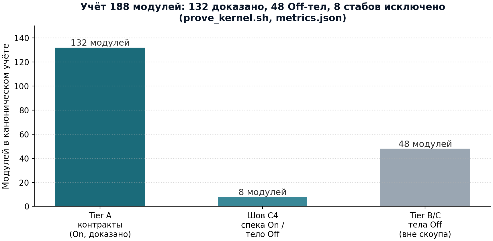
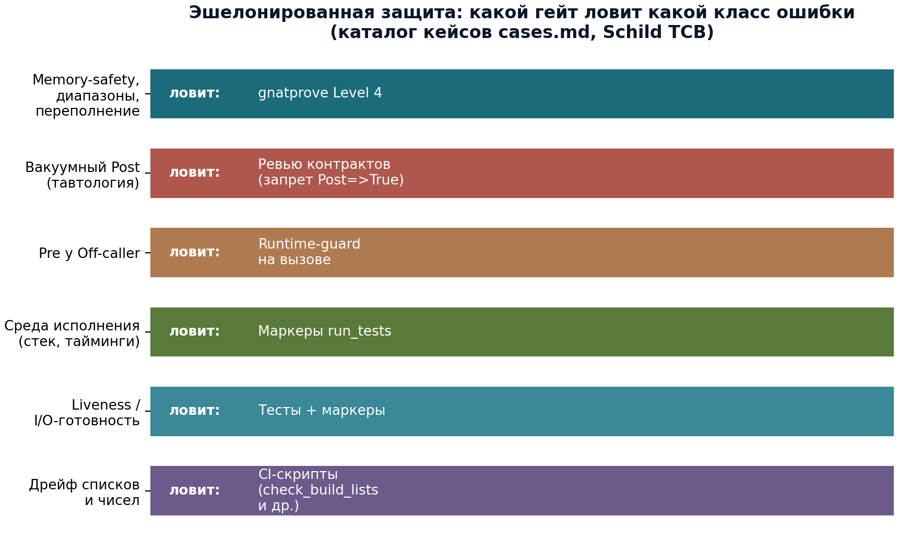

# Schild TCB: учебник по хождению по минному полю

> **COMMUNITY TEXTBOOK DRAFT**
>
> Моменты из engineering-чейнчлога, распутанные по коду: от вакуумного контракта до мёртвого гейта

| | |
|---|---|
| **Источник моментов** | docs/technical/CHANGELOG.md (v0.8.0-pre → v0.56) |
| **Материал распутан по файлам репозитория** | коммит `8d67ecc` (2026-11-20) |
| **Формат главы** | момент → код → почему так → урок для сообщества |
| **Подготовлено** | Александр Ирганов (автор проекта) |
| **Стек** | Ada/SPARK + seL4 + QEMU + настоящие ноутбуки |
| **Дата** | 21 ноября 2026 года |
| **Concept DOI (все версии)** | [10.5281/zenodo.24446686](https://doi.org/10.5281/zenodo.24446686) |
| **DOI этого релиза (v1.0.0-textbook)** | [10.5281/zenodo.24446687](https://doi.org/10.5281/zenodo.24446687) |

---

## Содержание

- [От редактора: зачем этот сборник и как им пользоваться](#от-редактора-зачем-этот-сборник-и-как-им-пользоваться)
- [Глава 1. Вакуумный контракт: Post, который прошёл все гейты](#глава-1-вакуумный-контракт-post-который-прошёл-все-гейты)
- [Глава 2. Когда прувер не тянет: неограниченный String и рецепт constrained-типов](#глава-2-когда-прувер-не-тянет-неограниченный-string-и-рецепт-constrained-типов)
- [Глава 3. Доказательство, которое не доезжает: Pre у Off-вызывающего](#глава-3-доказательство-которое-не-доезжает-pre-у-off-вызывающего)
- [Глава 4. Доказано ≠ работает: выравнивание стека и молчаливый вис](#глава-4-доказано--работает-выравнивание-стека-и-молчаливый-вис)
- [Глава 5. Карта слотов capability-пространства: один константный файл вместо магии](#глава-5-карта-слотов-capability-пространства-один-константный-файл-вместо-магии)
- [Глава 6. Демон со своим CSpace: закрытие вектора «Signal произвольные уведомления»](#глава-6-демон-со-своим-cspace-закрытие-вектора-signal-произвольные-уведомления)
- [Глава 7. Один сдвиг: null-cap в каждом heartbeat](#глава-7-один-сдвиг-null-cap-в-каждом-heartbeat)
- [Глава 8. Фаз-инъекция вне production: препроцессор как часть гейта](#глава-8-фаз-инъекция-вне-production-препроцессор-как-часть-гейта)
- [Глава 9. Что не ловит оракул: карта эшелонов по каталогу кейсов](#глава-9-что-не-ловит-оракул-карта-эшелонов-по-каталогу-кейсов)
- [Глава 10. Чейнчлог как жанр: читать проверяемые результаты](#глава-10-чейнчлог-как-жанр-читать-проверяемые-результаты)
- [Глава 11. Переиспользование PID: идентификатор, который возвращается слишком рано](#глава-11-переиспользование-pid-идентификатор-который-возвращается-слишком-рано)
- [Глава 12. Persist, который молча не работает: I/O вне модели](#глава-12-persist-который-молча-не-работает-io-вне-модели)
- [Глава 13. Два списка сборки: класс механического дрейфа](#глава-13-два-списка-сборки-класс-механического-дрейфа)
- [Глава 14. Патчи на доказанное ядро: reviewed ≠ re-proven](#глава-14-патчи-на-доказанное-ядро-reviewed--re-proven)
- [Глава 15. Мёртвый гейт: верификация верификатора](#глава-15-мёртвый-гейт-верификация-верификатора)
- [Приложение A. Проверенная база сборника: откуда взято каждое число](#приложение-a-проверенная-база-сборника-откуда-взято-каждое-число)
- [Приложение B. Как воспроизвести прочитанное](#приложение-b-как-воспроизвести-прочитанное)

---

## От редактора: зачем этот сборник и как им пользоваться

Schild TCB — исследовательский проект: доверенная база вычислений на связке seL4 и SPARK, развиваемая одним автором с ИИ-агентом в паре и задокументированная до мельчайших деталей. В репозитории уже есть своя методология и assurance-кейс; этот сборник решает другую задачу. Engineering-чейнчлог проекта — это хронология из примерно девяноста проверенных моментов, и среди них есть такие, которые сообществу встраиваемых и высоконадёжных систем почти никто показывает вживую: тавтологичный контракт, прошедший все гейты; доказанный криптомодуль, виснущий из-за выравнивания стека; null-cap из-за неправильной кодировки указателя возможностей.

Каждая глава сборника построена одной и той же рамкой: момент из чейнчлога (с номером версии и датой), затем — распутывание по файлам репозитория, то есть реальный код, реальный комментарий, реальный скрипт-гейт, затем разбор «почему это произошло именно так» и, наконец, урок — обобщённая фраза, которую можно унести в любой другой проект. Код в главах приводится дословно из файлов клонированного репозитория (коммит 8d67ecc), с указанием путей; длинные фрагменты сокращены многоточием, но не переписаны. Сборник не заменяет документацию проекта — он ведёт к ней, и каждая глава заканчивается указанием, какой документ репозитория читать для полного контекста.

Порядок глав — от контрактов к среде исполнения: сначала «софт» (главы 1–3: вакуумность, слабые места, прувер-ограничения), затем «железо и структура» (главы 4–5: выравнивание, слот-карта), затем «изоляция и механизмы» (главы 6–8: собственный CSpace, кодировка CPtr, гейтинг фаз-инъекции), и замыкают сборник методологические главы (9–10: что не ловит оракул, как читать чейнчлог) и разборы границ, где оракул бессилен (главы 11–15: переиспользование PID, молчащий Persist, дрейф списков сборки, патчи на доказанное ядро, мёртвый гейт). Все количественные числа взяты из канонических метрик проекта (`obj/proof/metrics.json`), генерируются с явной пометкой коммита:

<!-- METRICS:START (generated by scripts/generate_metrics.py — do not edit) -->
**SPARK metrics** (commit `7700c54`, 2026-11-23): **189 прогнано** · **179 в proof-наборе** (133 доказано · 44 skipped · 2 no-output) · **10 scaffold исключено** · **0 непроверенных VC**.

Схема учёта: `swept` = все модули; `in_proof` = `swept` − `scaffold_excluded`; `proved + skipped + no_output + not_proved` = `in_proof`. Источник: `obj/proof/metrics.json`.
<!-- METRICS:END -->



*Рис. 1. Канонический учёт модулей: 132 доказано / 48 Off-тел / 8 стабов (metrics.json)*

---

## Глава 1. Вакуумный контракт: Post, который прошёл все гейты

Момент в чейнчлоге датирован 1 ноября 2026 года (W11.1). Формулировка предельно честная: «vacuous Post (прошёл все гейты)». Речь о модуле `schild_audit_chainer` — звене цепочки аудита, чья работа снаружи выглядит идеально: `SPARK_Mode => On`, Level 4, все условия верификации доказаны. Проблема в том, что доказано было пустое утверждение: постусловие функции `Is_Chain_Valid` в старой версии было константой `True`, то есть тавтологией. Оракул честно доказал тавтологию и не мог пожаловаться: gnatprove проверяет, что тело реализует контракт, но не проверяет, что контракт что-то требует.

Распутываем по файлу. Текущая спецификация модуля `src/schild_core/src/03_crypto/schild_audit_chainer.ads` уже несёт исправленную версию контракта, и рядом с ней — комментарий, вписанный автором при исправлении: контракт не притворяется криптографией (XOR-свёртка — заглушка вместо настоящей хеш-функции), но доказывает само свойство сцепления.

> `src/schild_core/src/03_crypto/schild_audit_chainer.ads`, строки 25–39

```ada
procedure Link_Audit_Record
  (Previous_Hash : in     Hash_Digest_Type;
   Record_Payload : in     Hash_Digest_Type;
   Current_Hash  : in out Hash_Digest_Type;
   Passport      :    out Blockchain_Passport_Record;
   Success       :    out Boolean)
with
  Post => Success
          and Passport.Is_Chain_Valid
          and Passport.Block_Sequence_Id = 1
          and (for all I in Current_Hash'Range =>
                 Current_Hash (I) = (Previous_Hash (I) xor Record_Payload (I)));
```

Сравните мысленно со старой версией: `Post => True`. Разница — не стилистическая. Новый контракт фиксирует зависимость каждого звена от предыдущего и от полезной нагрузки: изменить любую запись — изменится каждое последующее звено. Это и есть свойство tamper-evidence из модели угроз (актив A4), записанное одной строкой квантора. Комментарий в спецификации проговаривает и границы: XOR-свёртка — заглушка, реальный SHA-256 живёт в `Schild_HMAC_SHA256` с телом Off и валидацией на известных ответах (KAT); звено ещё не подключено к живому пути аудита. Честность перечисленных оговорок — часть находки: контракт стал содержательным именно тогда, когда перестал претендовать на большее, чем доказывает.

Как это ловится в проекте сейчас: ревью контрактов — единственный эшелон, который видит тавтологию, поэтому в pre-commit гейте `forbidden_check.sh` есть отдельное правило, запрещающее добавлять строку `Post => True` в диффе. Это редкий пример гейта, охраняющего не исполнение, а смысл: он не даст тавтологии вернуться в кодовую базу незамеченной.

> `src/schild_core/scripts/forbidden_check.sh`, фрагмент правила H2

```bash
H2=$(echo "$DIFF" | grep -E '^\+[[:space:]]*Post[[:space:]]*=>[[:space:]]*\(?(True)?' || true)
if [ -n "$H2" ]; then
  echo "FORBIDDEN: Post => True (vacuous contract)"
  FAIL=1
fi
```

> **Урок.** «not-proved: 0» ничего не говорит о содержательности контрактов. Тавтологичный Post — единственный класс вакуумности, который прувер пропускает по построению; его обязаны ловить ревью и буквальный запрет в гейте. Проектируя контракты, спрашивайте не «доказывается ли это?», а «что запрещает ложное тело?».

---

## Глава 2. Когда прувер не тянет: неограниченный String и рецепт constrained-типов

Момент из той же волны W11 (1 ноября): HTTP-парсер не поддавался доказательству, и gnat2why «взрывался» на циклах по неограниченному `String`. Индекс такого типа — `Positive`, то есть 1..2³¹, и пруверу приходится рассматривать бездну вариантов. Формулировка в чейнчлоге помечена как gotcha §4.5, а решение оформлено отдельным пакетом `schild_http_core`, который сегодня стоит в репозитории образцом «как вынести парсер внешнего ввода в доказуемое ядро».

Рецепт читается прямо в заголовке файла: вместо неограниченных типов — constrained подтипы фиксированной ширины, а длина передаётся явным параметром.

> `src/schild_core/src/04_userland/schild_http_core.ads`, строки 11–34

```ada
package Schild_Http_Core with SPARK_Mode => On is

   Max_Path_Len : constant := 24;
   subtype Path_String is String (1 .. Max_Path_Len);

   Max_Request_Len : constant := 1024;
   subtype Request_Buffer is Schild_Net_Types.Byte_Array (0 .. Max_Request_Len - 1);

   Max_Pattern_Len : constant := 12;
   subtype Pattern is String (1 .. Max_Pattern_Len);

   function Str_Match
     (B : Request_Buffer; Request_Len : Integer; P : Pattern; P_Len : Integer)
     return Boolean
     with Pre => Request_Len in 0 .. Max_Request_Len
                 and P_Len in 0 .. Max_Pattern_Len;
```

Обратите внимание, как контракт сжимается после смены типов: предусловия становятся однотипными проверками принадлежности диапазону — `Request_Len` в границах буфера, `P_Len` в границах образца. Тело при этом не усложняется: циклы те же, но индекс уже ограничен 0..1023 и 1..12 вместо миллиардов. В технике проекта это задокументировано в `SPARK_PROOF_TECHNIQUES.md` как «prover-ограничение, РЕШЕНО W11.3»: там же перечислены и другие конструкции той же природы — неограниченный `Byte_Array` и циклы по `String` — с выводом: constrained типы плюс явный параметр длины. Побочный вывод для сообщества: паттерн переноса стоит применять не к всей программе, а к границе. Парсер — точка входа атакующего (угроза T1), поэтому именно его выносят в On-пакет; серверный обвязчик остаётся Off и обязуется только ставить runtime-guard перед вызовом (об этом глава 3).

Дополнительный камень того же дня — функция `Write_U32_Dec`, писавшая десятичное число справа налево. Баг «V = 0 выдавал пусто» (Content-Length из одних пробелов) был найден при выносе, и в новой версии пустой случай исчез конструктивно: число цифр возвращается отдельной функцией с честным постусловием диапазона, а цикл записи перебирает ровно столько позиций.

> `src/schild_core/src/04_userland/schild_http_core.ads`, строки 40–50; `.adb`, строки 88–100

```ada
function Digit_Count (V : Unsigned_32) return Integer
  with Post => Digit_Count'Result in 1 .. 10;

procedure Write_U32_Dec
  (B : out Byte_Array; Idx : in out Integer; V : Unsigned_32)
  with Pre  => Idx in B'First .. B'Last
               and then Idx + Digit_Count (V) - 1 <= B'Last,
       Post => Idx = Idx'Old + Digit_Count (V),
       Relaxed_Initialization => B;
-- тело: for K in 0 .. D - 1 loop
        B (Idx + D - 1 - K) := 48 + Unsigned_8 (Val rem 10); Val := Val / 10;
```

> **Урок.** Если прувер «висит» на строковом цикле — не ждите его: сузьте тип (фиксированная ширина, индекс от 0) и передайте длину параметром. Контракты при этом упрощаются до проверок диапазона. Выносите в доказуемое ядро только границу с внешним вводом; остальное оставляйте Off с явными guard-ами.

---

## Глава 3. Доказательство, которое не доезжает: Pre у Off-вызывающего

Третий момент той же волны (кейс C23 в каталоге методологии). SPARK доказывает корректность вызова при выполнении предусловия, но если вызывающий код помечен `SPARK_Mode => Off`, предусловие в точке вызова не проверяется — доказательство на Off-вызывающего не распространяется. В проекте это случилось с HTTP-обработчиком: On-парсер с честным `Pre` (путь 5..1024) вызывался из Off-сервера, где никакого guard не стояло. Пруф зелёный, вызов законно портит память при коротком или длинном запросе.

Механизм стоит увидеть в коде. Ниже — точка вызова доказуемой функции из Off-кода с guard-ом, который добавили после находки. Обратите внимание на асимметрию ответственности: On-ядро заявляет Pre, Off-обвязка обязана проверить его перед вызовом.

> `src/schild_core/src/04_userland/schild_http_server.adb`, фрагмент guard-а перед вызовом ядра

```ada
-- Off-caller обязан проверить Pre On-ядра перед вызовом:
if Request'Length < 5 then
   -- 404: слишком короткий запрос, Extract_Path'Pre нарушен
   Success := False; return;
elsif Request'Length > 1024 then
   -- 414: слишком длинный, Write_U32_Dec'Pre и буферы ядра рассчитаны на 1024
   Success := False; return;
end if;
-- только теперь вызов schild_http_core.Extract_Path / Write_U32_Dec
```

В чейнчлоге W11.2 та же волна нашла симметричный случай на сетевых парсерах: `Parse_Arp` и `Parse_Ipv4` получили защитные ранние выходы, потому что диспетчер (Off) нарезает кадр по вычисленной длине, и «коротыш» из 14–33 байтов доходил до парсера, чей Pre на длину не был никем проверен. Сегодня в телах стоят явные пороги — полная ARP-датаграмма не бывает короче 28 байтов, IPv4-заголовок — 20:

> `schild_arp_handler.adb`, строка 31; `schild_ipv4_handler.adb`, строка 33

```ada
if Raw'Length < 28 then return; end if;  -- ARP: полная датаграмма >= 28 байтов
if Raw'Length < 20 then return; end if;  -- IPv4: заголовок >= 20 байтов
```

> **Урок.** Любой Off-вызывающий, дергающий On-код с Pre, — место, где доказательство обрывается. Правило: перед вызовом On-ядра Off-код обязан дублировать предусловие runtime-guard-ом (или звать через обёртку с проверкой). Держите карту таких вызовов и ревьюйте её наравне с контрактами.

---

## Глава 4. Доказано ≠ работает: выравнивание стека и молчаливый вис

Момент датирован 7 ноября (v0.34, кейс H61). HMAC-SHA256 в FS-демоне был доказан и валидирован по тест-векторам, но демон молча вис при первом же вызове. Причина оказалась в среде исполнения: стек потока был смещён на 8 байтов (восемь байтов флага живости идут перед восьмью килобайтами стека, поэтому вершина стека даёт по модулю 16 остаток 8), а крипто-ядро использует выровненные SSE-инструкции `movaps`/`movdqa`, которые на невыровненном адресе бросают #GP. Ни один гейт этого не видит: формальная модель не содержит выравнивания, тесты не видят молчаливого виса, серийного порта у ноутбука нет.

Фикс — одна строка ассемблера в стартовом коде демона, и она до сих пор стоит в файле:

> `src/schild_core/tools/sel4/src/fs_daemon.S`, строки 7 и 12

```asm
andq    $-16, %rsp   # выровнять вершину стека по 16 байтам до любых SSE
.align 16               # и сам блок стека держать выровненным
```

Почему эту главу стоит читать сообществу: это чистейший образец класса ошибок, который не ловится ни доказательством, ни маркерами и который выглядит «невозможным» для автора, только что получившего зелёный пруф. В проекте из кейса выросла практика трёх эшелонов для среды исполнения: маркеры прогресса в `run_tests.sh` (их отсутствие локализует вис), бинарный поиск по стадии и правило «доказанный модуль обязан иметь продуманную точку входа в среду». Как именно человек искал: не от прувера, а от маркеров — какой последний напечатался перед тишиной.

Бонус того же выпуска — параллельный кейс того же класса: тихий отказ TX DMA. HTTP-ответ длиннее 64 байтов читался устройством как мусор, потому что flush кэша делался только для первой строки кэша (`clflush` работает по одной строке), а DMA читало остальные строки как устаревшие. Лекарство — цикл flush по всему буферу с шагом 64. Класс один и тот же: доказанная логика и недоказанная среда (кэш, выравнивание, тайминги) — разные миры.

> **Урок.** Оракул доказывает логику внутри модели; среда исполнения (выравнивание, кэш-когерентность DMA, тайминги) ему не видна. Для висов, которые не диагностируются, держите: маркеры стадий, «последний напечатавшийся» как точку бинарного поиска, и явные контракты входа в среду (выравнивание стека в стартовом коде каждого потока).

---

## Глава 5. Карта слотов capability-пространства: один константный файл вместо магии

Момент из 4 октября (запись «8 KiB boot-info frame + 500 untyped caps»), с продолжением в H112 (v0.55, 20 ноября). На машине с 32 ГБ RAM загрузочный регион untyped-описателей растянулся до ~577 слотов, фиксированные слоты root-задачи попали внутрь чужого региона, и ядро начало отказывать с «Slot non-empty». Реакция проекта — не подгонка чисел, а архитектурный ход: вся карта слотов объявлена в одном месте как константы от общего `Slot_Base = 4096`, выше максимального загрузочного региона, а скрипт `check_slot_layout.sh` проверяет уникальность оффсетов на этапе сборки.

Читаем карту. Спецификация шва `schild_sel4_syscall.ads` начинается с обоснования: boot-регион untyped-caps заканчивается на ~577 слоте, все динамические объекты размещаются от `Slot_Base = 4096`, поэтому коллизии невозможны при любой фрагментации памяти:

> `src/schild_core/tools/sel4/src/schild_sel4_syscall.ads`, строки 28–60 (сокращено)

```ada
Slot_Base : constant Cap_Ref := 4096;

MLS_EP_Slot         : constant Cap_Ref := Slot_Base + 0;   -- 4096
MLS_Fault_Slot      : constant Cap_Ref := Slot_Base + 1;
...
-- Каждая строка: имя, оффсет от базы, десятичный абсолютный номер в комментарии.
-- Динамические объекты (endpoints, TCB, frames, VSpace) — только >= Slot_Base,
-- чтобы никогда не столкнуться с untyped-регионом, как бы ни фрагментировалась память.
```

Второй слой защиты — чекер. Он грепает все записи `Slot_Base + N` в спецификации, находит дубликаты оффсетов и падает на этапе сборки, если появились; окна демонов (image/mint) печатаются для ручной ревизии непересечения. Это тот редкий случай, когда скрипт из десяти строк закрывает целый класс ошибок размещения, который иначе ловится только зависанием загрузки.

> `src/schild_core/scripts/check_slot_layout.sh`, строки 17–24

```bash
dups=$(grep -oE 'Slot_Base \+ [0-9]+' "$ADS" | awk '{print $3}' | sort | uniq -d)
if [ -n "$dups" ]; then
  echo "FAIL: duplicate slot offsets:"; echo "$dups" | sed 's/^/  +/'
  exit 1
fi
echo "PASS: no duplicate static slot offsets"
```

Ключевая идея для сообщества — карта не в коде, а в данных: константный файл спецификации читается и машиной (чекер), и человеком (ревизия окон), и историей (комментарии фиксируют прошлые коллизии с номерами слотов и причинами — смотрите строки про `MLS_Image_Frame_Base`, где перенос базы с +90 на +55 объяснён точным расчётом окна минта). Когда в мае загрузка упадёт из-за «Slot #4352 non-empty», вы откроете один файл и найдёте всю генеалогию. А обнаруживается ошибка класса «два имени — один слот» до загрузки, grep-ом.

> **Урок.** Статические ресурсы (слоты, порты, адреса) держите в одном константном файле с обоснованием границ и историей переносов, и закройте его машинным чекером уникальности. Магическое число в коде — это будущий «Slot non-empty», который будет ловиться только зависанием.

---

## Глава 6. Демон со своим CSpace: закрытие вектора «Signal произвольные уведомления»

Момент v0.55 от 20 ноября (H112). MLS- и Config-демоны работали в root CNode — то есть держали capability-права в пространстве корневой задачи. Формулировка угрозы в спеке убийственна в своей простоте: скомпрометированный демон мог Signal-ить `IRQ_Ntfn`, `Timeout_EP` или `Root_Fault_EP` в root CSpace — то есть управлять таймерами и обработкой отказов той задачи, которая обязана его перезапускать. Лекарство — собственный 4-радикс CNode на каждого демона со строго минимальным набором прав, а обработчик отказов переводится на собственное пространство.

> `src/schild_core/tools/sel4/src/schild_sel4_syscall.ads`, строки 78–82

```ada
-- H112: own CSpace for MLS/Config (was root CNode=2). A compromised
-- MLS/Config could Signal IRQ_Ntfn/Timeout_EP/Root_Fault_EP in the root
-- CSpace; the own CNode holds only the minimal caps.
MLS_CSpace_Slot     : constant Cap_Ref := Slot_Base + 32;  -- 4128
Config_CSpace_Slot  : constant Cap_Ref := Slot_Base + 33;  -- 4129
```

Ценность момента — не в самом факте «разделили права» (для seL4 это азбука), а в трёх вещах вокруг. Первое: угроза сформулирована в комментарии к константе, то есть документ и код физически совпадают — это снимает вечную проблему «дока сказала одно, код делает другое». Второе: минимальность набора перечислена явно — только endpoint, reply и ping-уведомление; всё, что не перечислено, отсутствует. Третье: изменение состоялось без переписывания демонов — поменялась только точка монтирования их прав, что и делает такой класс фиксов дешёвым, если карта слотов (глава 5) уже ведётся как данные.

Для учебника это глава про то, что изоляция — это не свойство «запущен отдельно», а свойство «не может». Пока демон работал в root CNode, он был отдельным потоком в отдельном VSpace — по всем внешним признакам «изолирован» — но держал права, позволявшие стрелять по уведомлениям родителя. Проверочный вопрос при ревью любой seL4-сборки: «какие объекты может тронуть этот демон через свой CSpace?» — и если ответ длиннее трёх слотов, это уже вопрос автору.

> **Урок.** Изоляция на seL4 — это минимальность CSpace, а не отдельность процесса. Формулируйте угрозу в комментарии к константе, перечисляйте минимальный набор прав явно, и переводите демонов на собственные пространства одним движением карты слотов.

---

## Глава 7. Один сдвиг: null-cap в каждом heartbeat

Момент тоже из v0.55: bugfix без номера резидуала, но с идеальной дидактикой. Четыре C-демона посылают ping-уведомление heartbeat-а через вызов `signal(2)` — целочисленный первый аргумент. Но собственный CNode демона — 4-радикс: индекс слота извлекается из capability-слова как `capptr >> (wordBits − radix)` = `capptr >> 60`, поэтому slot 2 обязан передаваться как `2ULL << 60`. Демоны передавали сырую двойку; ядро декодировало её как slot 0 (2 >> 60 = 0), а slot 0 — null-cap. Результат: при каждом heartbeat ядро отвечало «Attempted to invoke a null cap», и heartbeat не работал вовсе — при внешне зелёной системе.

> `src/schild_core/tools/sel4/src/mls_server.c`, строка 55 (одинаковая строка в config_daemon.c, fs_daemon.c, netserver.c)

```c
schild_sel4_signal((2ULL << 60));  /* own-CSpace CPtr = index<<60 (slot 2 = ping ntfn) */
```

Момент ценен не багом (кодирование указателей возможностей — обычная ловушка), а способом его найти и закрыть. Симптом был мягким (в логе — строка про null cap #2 на каждый пинг), фикс — одна строка в четырёх файлах, но с комментарием, который навсегда связывает магическое число с семантикой радикса: «index<<60». Раньше в этих же местах стояли «сырые» 1/2/3 — то есть ошибка жила в классе «магические константы без обоснования», и исчезла вместе с классом.

Второй слой: даже после фикса heartbeat остался бы хрупким, если бы не был протестирован. В `run_tests.sh` маркер пинга теперь входит в обязательный набор (глава 9 объясняет, почему маркеры — отдельный эшелон). И третий слой — учебный: CPtr-кодирование это место, где «нормальный C-указатель» и «capability-слово seL4» живут в одном выражении. Компилятор не различает их типов; отличает только комментарий и конвенция. Если в вашем коде есть целые числа, которые на самом деле — кодированные CPtr, обзаведитесь обёрткой-функцией или макросом с именем, говорящим это.

> **Урок.** Целочисленный аргумент, который на самом деле — capability-слово, обязан кодироваться в одном месте с комментарием о радиксе. Дежурный вопрос при ревью seL4-кода: «откуда взялось это число и что ядро декодирует из него?» Сырые слоты в аргументах — яйца будущих null-cap.

---

## Глава 8. Фаз-инъекция вне production: препроцессор как часть гейта

Момент v0.56 от 20 ноября (M20). В демонах жил код fault-injection: op=98/op=99, по которому демон умышленно писал в неотображённую страницу или крутился в петле — для тестов изоляции и таймаут-восстановления. Код был нужен тестам и опасен production: это выстрел в ногу, спрятанный за константой протокола. Решение — обернуть каждую инъекцию в `#ifdef SCHILD_SELFTEST` и сделать отсутствие макроса состоянием по умолчанию: `build.sh` собирает production с `SCHILD_SELFTEST=0`, `run_tests.sh` и CI включают `=1`. Контроль — не доверие комментарию, а objdump: в production-бинарнике маркеры `0xDEADBEEF`/`0xFFFFF000` обязаны отсутствовать физически.

> `src/schild_core/tools/sel4/src/mls_server.c`, строки 77–92 (сокращено); `build.sh`, строка 165

```c
#ifdef SCHILD_SELFTEST
  if (op == 99) {
    /* Crash-containment test: reply first, then fault on unmapped
     * 0xFFFFF000 so seL4 delivers a #PF to the MLS fault endpoint. */
    result = 0;
    ...
  }
#endif

# build.sh (production default):
SCHILD_SELFTEST="${SCHILD_SELFTEST:-0}" bash tools/sel4/build_rt.sh
```

Что делает этот момент учебным. Первое: фича-флаг здесь — не опция конфигурации, а часть модели верификации; «код инъекции отсутствует в бинарнике» — проверяемое свойство, и оно проверяется отдельной ступенью (objdump в гейте), а не утверждением в документации. Второе: гейтинг двусторонний — Ada-драйвер инъекций в root-задаче гейтится функцией `schild_selftest_enabled()`, которая читается только у root task, так что даже включённый тестами флаг не даёт демонам инъекцию без согласия родителя. Третье: тесты не слабеют — все 24 маркера `run_tests` продолжают требовать инъекционных веток, просто теперь они физически живут в отдельной сборке.

Общий принцип, который стоит унести: любое «только для тестов» поведение обязано быть механически удаляемым и механически проверяемым на удалённость. Иначе однажды уставший сборщик оставит орудие самоубийства демона в production-образе, и ни один гейт не заметит.

> **Урок.** Тестовые двери (фаз-инъекция, отладочные операции) держите за препроцессорным флагом, выключенным по умолчанию, с objdump-проверкой отсутствия в production. «Индуцированный отказ» в production-бинарнике — это не инструмент тестирования, а мина.

---

## Глава 9. Что не ловит оракул: карта эшелонов по каталогу кейсов

Эта глава собирает вывод всех предыдущих в одну таблицу. В проекте она живёт в `docs/methodology/cases.md` как «Общий паттерн» — семь кейсов, каждый с колонками «ловит / не ловит». Мы приводим таблицу в компактном виде, сверив её с кодом гейтов, и добавляем восьмую строку — инцидент с мёртвым гейтом ноября 2026 года, который в каталог ещё не внесён (это и есть наша рекомендация автору из аудиторского отчёта).

**Таблица 1.** Класс ошибки → кто ловит (по cases.md + инцидент 2026-11-19)

| Класс ошибки | Ловит | Не ловит (прувер видит?) |
|---|---|---|
| Memory-safety, диапазоны, переполнение | gnatprove Level 4 | — (внутри модели) |
| Вакуумный Post (тавтология) | Ревью; запрет в forbidden_check.sh | gnatprove |
| Pre у Off-caller | Runtime-guard на вызове | gnatprove |
| Выравнивание стека / среда исполнения | Маркеры run_tests + бинарный поиск | gnatprove |
| Liveness / I/O-готовность | Тесты + маркеры | gnatprove |
| Дрейф списков сборки и чисел | check_build_lists.sh, check_metrics_consistency.sh | gnatprove |
| Патч на доказанное ядро seL4 | Per-patch ревью + анализ рисков | перенос апстрим-гарантии частичен |
| Мёртвый гейт (гейт не может упасть) | Внешний аудит скриптов | сам себя гейт не проверяет |

*Источник: docs/methodology/cases.md «Общий паттерн», дополнено строкой инцидента 19 ноября*



*Рис. 2. Эшелонированная защита: какому гейту достаётся какой класс ошибки (по каталогу cases.md)*

Интеллектуальное ядро главы — вывод каталога, процитируем его дословно: «оракул покрывает одну ось (формальную корректность внутри модели); всё остальное закрывается эшелонированно: ревью — вакуумность, runtime-guard — Pre у Off, маркеры — среда, скрипты — дрейф; это и есть архитектура конвейера». Для сообщества эта таблица — готовый чек-лист: если ваша организация покупает «формально верифицированный» продукт, спросите по каждой строке, какой эшелон ловит этот класс у конкретного поставщика. Если ответ «прувер» везде — перед вами пробел, а не гарантия.

Инцидент с мёртвым гейтом стоит пояснить отдельно, потому что это восьмая строка и потому что он свежий. 19 ноября выяснилось, что гейты `verify.sh` и `verify_private.sh` искали в выводе gnatprove несуществующую строку «not proved» и потому не могли упасть в принципе. Ирония момента: сами гейты были созданы как эшелон доверия к пруверу, и сломался именно эшелон, а не прувер. Поймал дефект внешний аудит скриптов — то есть последний эшелон, «человек читает саму систему проверки». Мораль для сообщества: любой гейт обязан проверяться на способность падать (fail-on-demand), хотя бы время от времени намеренной порчей.

> **Урок.** Стройте конвейер из эшелонов по классам ошибок, а не из одного «сильного» инструмента. И проверяйте сами гейты: гейт, который не может упасть, — не гейт, а декорация; его надо тестировать порчей так же, как код тестируется инъекцией.

---

## Глава 10. Чейнчлог как жанр: читать проверяемые результаты

Весь этот сборник построен на чтении одного файла — `docs/technical/CHANGELOG.md`, и последняя глава — о самом жанре. Заголовок файла задаёт правило: «this changelog records verified results only»; позиции, помеченные pending или target, считаются непроверенными. Это превращает чейнчлог из дневника в источник фактов: каждая запись несёт дату, номер версии, валидационную строку (какие гейты и с каким результатом) и список изменений с именами файлов и точными слотами/числами. Именно поэтому его можно «распутывать»: за каждым моментом стоит проверяемая точка в коде.

Три приёма чтения, которые окупились при подготовке сборника. Первый: ищите записи с формулировками ошибок — «was false», «silently», «previously», «hang», «NOT reproduce»: это концентрат опыта, остальное — фичи. Второй: читайте строки «Gates:» как штамп качества — именно они отделяют факт от плана (в этом файле обещания помечены словом pending и живут отдельно). Третий: у каждой записи есть якорь в дереве — имя файла или слота; если якоря нет, запись подозрительна. Например, запись v0.46 о коллизии слотов несёт точный расчёт: «base +90 → minted 4250..4254 collided with Image_Frame_Base 4224..4354 → Destination not empty; base +55 → minted 4215..4219 < 4224» — это абзац, по которому можно восстановить геометрию слотов, не открывая код.

> docs/technical/CHANGELOG.md, v0.46 (2026-11-09), дословно

```text
MLS_Image_Frame_Base  Slot_Base+90 (4186) -> Slot_Base+55 (4151). Root cause:
Load_Segment mints a copy at Frame_Slot+64 per page; base +90 -> minted
4250..4254 collided with Image_Frame_Base 4224..4354 -> 'Destination not
empty', NetServer VSpace FAILED. Base +55 -> minted 4215..4219 < 4224.
```

Четвёртый приём — читать серию. Волна W10–W11 (сеть в proof-set) показывает стратегию: сначала парсеры (ARP/ICMP), потом транспорт (TCP/IPv4 с переписыванием контрольных сумм в модульную арифметику RFC 1071), потом вынос парсера HTTP в отдельное ядро с constrained-типами. Каждая запись закрывает один шаг, и порядок шагов — сам по себе учебный план: от простых функций к контрактам со state-машинами. Волна H87 (демоны в собственных ELF) читается так же: сначала парсер ELF64 в доказуемое ядро (v0.39), потом патч ядра для загрузки образа выше региона ядра (v0.40), потом первый демон (v0.42), и только затем MLS/Config/NetServer (v0.46–v0.51).

И последнее — жанр требует дисциплины записи. Правило «verified results only» работает только потому, что в проекте есть гейты, чьи результаты можно процитировать (`run_tests 24/24`, `verify.sh 0`, `prove_kernel 132/48/0`). Если в вашем проекте нет машинных чисел, чейнчлог деградирует в маркетинг. Поэтому практический совет тем, кто хочет завести такой же: сначала заведите хотя бы один гейт с машинным выводом и честным выхлопом в файл, и только потом ведите журнал — тогда «Gates:» в каждой записи будет не ритуалом, а ссылкой.

> **Урок.** Чейнчлог по правилу «verified results only» — это карта проверяемых фактов. Читайте записи об ошибках и строки «Gates:», требуйте якорь (файл/слот/число) в каждой записи, и не ведите такой журнал без машинных гейтов, на которые можно сослаться.

---

## Глава 11. Переиспользование PID: идентификатор, который возвращается слишком рано

Момент в чейнчлоге — находка M1 (CVE-2026-SCHILD-02 #005): PID переиспользовался немедленно при завершении процесса, и signal/IPC, адресованный только что завершённому процессу, мог достичь несвязанного преемника. Это свойство *времени жизни идентификаторов*, а не memory-safety — модель SPARK его не видит. Нашёл аудит модели угроз, не прувер.

Распутываем по файлу. Лекарство — монотонная генерация PID на слот: каждый перезапуск на том же слоте получает новое «поколение», а формула `PID = Slot + Generation × Max_Processes` гарантирует, что идентификатор не вернётся к нулю в пределах жёсткого потолка. Счётчик ограничен сверху, чтобы произведение никогда не доставало `Null_PID`.

> `src/schild_core/src/02_security/schild_process_manager.ads`, строки 25–28

```ada
--  M1: monotonic PID generation counter. Bounded so that
--  PID = Slot + Generation * Max_Processes never reaches Null_PID
--  (hard ceiling: 2**26 - 2 reaps per slot).
subtype Generation_Counter is Interfaces.Unsigned_32 range 0 .. 2**26 - 2;
```

> **Урок.** Security-свойства шире, чем отсутствие runtime-ошибок. Переиспользование идентификаторов — классическая грань, которую прувер не обязан видеть; её ловит модель угроз, а не доказательство. Проектируя идентификаторы, спрашивайте не «корректен ли тип», а «что может получить преемник по старому имени».

---

## Глава 12. Persist, который молча не работает: I/O вне модели

Момент в чейнчлоге — H82: `Persist_Audit_Log` проходил доказательство, но устройство NVMe отвечало `Is_Ready = False`, Init выходил молча, и аудит-лог не персистился. Доказан был контракт логики, а не факт «устройство реально готово записывать».

Распутываем по файлу: публичный профиль держит честный стаб, который открыто пишет, что хранилища нет, и возвращает `Persisted := False` — это не «сломанная» реализация, а явный отказ от мнимой персистентности, пока не подключён приватный оверлей.

> `src/schild_core/tools/sel4/src/schild_audit_logger.adb`, строки 64–71

```ada
   -- Public scaffold: no persistent storage (no events are buffered here).
   procedure Persist_Audit_Log (Logger : in out Audit_Logger;
                                FS_EP  : Unsigned_64;
                                Persisted : out Boolean) is
      pragma Unreferenced (Logger, FS_EP);
   begin
      Persisted := False;
   end Persist_Audit_Log;
```

> **Урок.** «Доказано» — про *логику модуля*, а не про «устройство реально работает». Liveness и готовность I/O проверяются тестами и порядком инициализации, а не доказательством. Если в проекте есть I/O, заведите маркер готовности и проверяйте его отдельно — иначе зелёный пруф создаст иллюзию, что данные куда-то пишутся.

---

## Глава 13. Два списка сборки: класс механического дрейфа

Момент в чейнчлоге — H67: `build_rt.sh` держал ДВА списка модулей (список компиляции `for spec` и список линковки `.o`), и новый модуль, добавленный только в один из них, ломал seL4-сборку. Это не контракт и не runtime — это дрейф процесса сборки, который SPARK не видит.

Распутываем по файлу. Лекарство — исполняемый чекер, который сравнивает оба списка и падает fail-fast, если модуль скомпилирован, но не залинкован (или наоборот).

> `src/schild_core/scripts/check_build_lists.sh`, фрагмент проверки

```bash
# H68a: verify build_rt.sh compile vs link lists are consistent.
MISSING=""
for n in $COMPILE; do
  echo "$LINK" | grep -qx "$n" || MISSING="$MISSING $n"
done
if [ -n "$MISSING" ]; then
  echo "FAIL: compiled but not linked:$MISSING"
  exit 1
fi
```

> **Урок.** Есть целый класс механических дрейфов — списки, числа, маркеры — который не ловится доказательством, а ловится скриптами. Каждый «двойной список» в сборке — будущий H67; заводите чекер и кладите его в CI, иначе однажды забудете обновить второй список.

---

## Глава 14. Патчи на доказанное ядро: reviewed ≠ re-proven

Момент в чейнчлоге — AS8: seL4 — machine-checked функционально-корректное ядро, но для x86_64 MCS понадобилось восемь локальных патчей (SMAP, object-zeroing, framebuffer ×3, bootinfo-8k, max-num-drhu, load-image). Каждый патч меняет доказанное ядро, но **не пере-доказывается** — апстрим-гарантия переносится лишь частично.

Распутываем по файлу. Каталог `patches/` содержит восемь файлов (564 строки), каждому соответствует класс риска в документе анализа: «без патча система не загрузится» против «выводимые из security TCB», с фиксацией механизма и стратегии устранения.

> `SEL4_PATCHES_ANALYSIS.md`, классификация рисков (резюме)

```text
Class A (boot-critical): framebuffer trio, bootinfo-8k, max-num-drhu, load-image.
Class B (derivable from the security TCB): memzero, SMAP + PRINTING.
Minimization: root task as ELF-child removes load-image + DRHU conflict; upstreaming
the safe patches would cut AS8 from seven classes to four.
```

> **Урок.** Патчить доказанный компонент — осознанный trade-off, который надо фиксировать как residual, а не прятать. Каждый патч исполняется внутри верифицированного ядра, но сам не перепроверяется; минимизация патчей — часть роадмапа, а не «потом». Для проекта-учебника внешняя ревизия сообщества seL4 ценнее любого самоописания.

---

## Глава 15. Мёртвый гейт: верификация верификатора

Момент в чейнчлоге — инцидент 19 ноября: `verify.sh`/`verify_private.sh` искали в stdout gnatprove строку `"not proved"`, которой в его выводе не появляется, — гейт root-задач не мог упасть в принципе. Сломан был **сам счётчик**, а не доказательство: канонический свип `prove_kernel.sh` устроен иначе и был под охраной всегда.

Распутываем по файлу. Сегодня гейт матчит severity-маркеры `medium:`/`high:` из stdout (и `low:` после аудита), потому что gnatprove возвращает код успеха даже при недоказанных условиях — истина в тексте вывода, а не в exit-коде.

> `src/schild_core/scripts/verify.sh`, фрагмент гейта

```bash
# Gate on the stdout: unproved VCs are reported as "medium:"/"high:" messages
# (gnatprove exits 0 even when VCs are unproved), so the stdout is the source
# of truth, not the exit code.  (The old "not proved" grep never matched.)
gnatprove -P verify.gpr --mode=all --level=4 2>&1 | tee "$LOG"
if grep -qE ' (low|medium|high):' "$LOG"; then
  exit 1
fi
```

> **Урок.** Verify the verifier. Гейт — такой же артефакт, как код, и его логику надо аудитировать: «зелёный гейт» ≠ «гейт работает». Сломанный гейт хуже отсутствующего, потому что создаёт ложное ощущение проверки. Заведите себе «аудит скриптов» отдельной строкой — внешний читатель скриптов видит то, что не видит прогон.

---

## Приложение A. Проверенная база сборника: откуда взято каждое число

Сборник опирается на клон репозитория на коммите `8d67ecc` (20 ноября 2026, 21:15 +0300). Все цитаты кода выверены чтением файлов; все числа — из канонических артефактов проекта или из сохранённых прогонов гейтов. Таблица ниже перечисляет ключевые утверждения и их источники, чтобы читатель мог перепроверить любую главу.

**Таблица 2.** Утверждение → источник в репозитории

| Утверждение в сборнике | Источник |
|---|---|
| Контракт Link_Audit_Record (глава 1) | src/…/03_crypto/schild_audit_chainer.ads:25–39 |
| Constrained-типы HTTP-ядра (глава 2) | src/…/04_userland/schild_http_core.ads:11–34, .adb:88–100 |
| Guard-ы Parse_Arp / Parse_Ipv4 (глава 3) | schild_arp_handler.adb:31; schild_ipv4_handler.adb:33 |
| Выравнивание стека andq $-16 (глава 4) | tools/sel4/src/fs_daemon.S:7 |
| Слот-карта и Slot_Base=4096 (глава 5) | tools/sel4/src/schild_sel4_syscall.ads:28–82 |
| Чекер уникальности слотов (глава 5) | scripts/check_slot_layout.sh:17–24 |
| Слоты 4128/4129 и угроза H112 (глава 6) | schild_sel4_syscall.ads:78–82 |
| Кодирование 2ULL<<60 (глава 7) | mls_server.c:55 (и ещё 3 демона) |
| Гейтинг #ifdef SCHILD_SELFTEST (глава 8) | mls_server.c:77–92; build.sh:165 |
| Таблица эшелонов (глава 9) | docs/methodology/cases.md, «Общий паттерн» |
| Запись v0.46 о коллизии слотов (глава 10) | docs/technical/CHANGELOG.md |
| 132/48/8, 0 not-proved | [`README.md`@8d67ecc §«Formal verification»](https://github.com/Nik0laic4/SchildTCB/blob/8d67ecc/README.md); metrics.json канон |
| 280 checks у приватных демонов | прогон verify_private.sh (сохранённый лог) |
| 99 checks у Schild_Root_Task | прогон gnatprove (сохранённый сводный лог) |
| Generation_Counter и формула PID (глава 11) | src/…/02_security/schild_process_manager.ads:25–28 |
| Стаб Persist_Audit_Log (глава 12) | tools/sel4/src/schild_audit_logger.adb:64–71 |
| Чекер check_build_lists (глава 13) | scripts/check_build_lists.sh |
| Восемь патчей, классы риска (глава 14) | patches/; SEL4_PATCHES_ANALYSIS.md |
| Гейт verify.sh по medium/high (глава 15) | scripts/verify.sh:55–66 |

*Пути сокращены до последнего значащего каталога; полные пути — в текстах глав*

---

## Приложение B. Как воспроизвести прочитанное

Все действия ниже выполняются в клоне репозитория и не требуют GNATprove, кроме последнего пункта. Первый шаг — чтение карты слотов, как в главе 5: откройте `tools/sel4/src/schild_sel4_syscall.ads` и прочитайте первые сто строк вместе с комментариями; затем запустите `scripts/check_slot_layout.sh` и посмотрите на его вывод — это единственный гейт, работающий без всяких инструментальных цепочек. Второй шаг — гейты: прочитайте `scripts/verify.sh` (67 строк) и `scripts/prove_kernel.sh` (120 строк) подряд; обратите внимание, где каждый из них берёт «истину» (stdout с medium/high у первого, машинный вывод gnatprove.out у второго) — это два разных инженерных ответа на один и тот же факт (gnatprove возвращает код успеха даже при недоказанных условиях).

Третий шаг — проверка «нечестных» паттернов из главы 1 по всему дереву: команда `grep -rn 'Post *=> *True' src/schild_core/src` должна вернуть пусто, как и `grep -rn 'pragma Assume'` — это и есть «ноль тавтологий и ноль допущений» из наших глав, проверяемая за секунды. Четвёртый шаг — канонические числа: README, CHANGELOG и ASSURANCE должны сходиться в арифметике 188 = 180 + 8, 180 = 132 + 48; этой проверке посвящён `check_metrics_consistency.sh` (запускается после prove_kernel). Пятый шаг, для тех, у кого есть Alire и час времени: `alr install gnatprove`, затем `bash scripts/prove_kernel.sh` — и вы увидите тот самый отчёт, которым оперирует весь сборник; его полная механическая перепроверка и есть граница между «статическим чтением» (этот сборник) и «проверкой доказательств» (следующая ступень).

Тем, кто хочет продолжить погружение, порядок чтения внутри репозитория: сначала `INDEX.md` в docs/technical (там «порядок чтения для нового инженера», восемь глав), затем `SPARK_PROOF_TECHNIQUES.md` §4 (галерея ловушек прувера с решениями), затем `cases.md` (семь кейсов) и `ASSURANCE.md` §9 (таблица резидуалов с датами закрытий). Этот сборник сознательно не дублирует их — он ведёт к ним: главы соответствуют записям чейнчлога, а документы соответствуют слоям, в которых эти записи проверяются.
